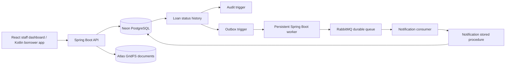

# Stored procedures, triggers and RabbitMQ

This guide explains the implementation added on 21 November 2026 and how to enable it.
Client/server architecture means clients request services from a server. Stored procedures,
triggers and message brokers are useful implementation choices; they are not requirements
for every client/server application. Here they serve specific reliability and learning goals.

## What runs where



The HTTP endpoints used by web and mobile remain compatible. A borrower still submits the
application; staff review it and make decisions. RabbitMQ carries asynchronous loan status
notifications, not client login requests, file bytes or payments. MongoDB keeps its existing
GridFS role. Automated credit scoring remains the existing in-process demo worker, and SMS,
credit bureau and payment settlement remain stubs.

## Database implementation

Flyway runs `V5__durable_loan_messaging.sql` and `V6__pin_messaging_routine_schema.sql` from
`src/main/resources/db/migration/` at startup. V6 fixes routine table lookup to the installation schema.
Keep applied migration files unchanged. V5 adds:

| Database object | Purpose |
|---|---|
| `loan_message_outbox` | Durable outgoing events, publication leases, attempts, publication and consumption timestamps |
| `loan_status_message_trigger` | Inserts one outgoing event whenever a new status history row is inserted |
| `loan_status_audit_trigger` | Inserts the status audit entry in that same transaction |
| `claim_loan_messages(limit, token)` | Stored procedure claiming up to ten events with `FOR UPDATE SKIP LOCKED` and a 120-second lease |
| `record_loan_notification(event_id, message)` | Stored procedure atomically marking an event consumed and inserting its notification |
| `notifications.source_event_id` | Unique non-null event identity preventing duplicate notifications |

PostgreSQL trigger bodies are **functions returning trigger**. The two procedures are actual
`CREATE PROCEDURE` objects invoked by Java using `CALL`, rather than functions renamed as
procedures. Neither procedure commits independently: the caller controls the transaction.

Status audit creation was removed from the old Java status audit subscriber, avoiding two
writers. Other audit events retain their existing subscriber. There is no historical replay:
V5 queues only new history inserts. Raw SQL updating `loan_applications.status` alone does
not create a history row; application workflow changes should still use the API/state machine.

For an approval, the status/history, audit entry and outbox event all commit or all roll back.
The relay claims a batch in a short transaction and releases database locks before contacting
RabbitMQ. It marks publication complete only after a positive broker confirmation and no
unroutable return. Failure leaves the event available for retry after 30 seconds; a worker
crash leaves a lease that another worker can recover after expiry.

Delivery is **at least once**: a crash after RabbitMQ accepts a message but before PostgreSQL
records publication can publish the same event again. The consumer loads the trusted event
from PostgreSQL using the UUID in the broker message. Its procedure creates at most one
in-app notification for that event. A consumer crash after commit but before ACK is safe to
redeliver. Internal status events without borrower-facing text are marked consumed without
creating a notification. This is not a claim of exactly-once network delivery.

## Modes and environment variables

| Variable | Current default | Vercel API after setup | Persistent worker |
|---|---|---|---|
| `MESSAGING_ENABLED` | `false` | `true` | `true` |
| `MESSAGING_WORKER_ENABLED` | `false` | `false` | `true` |
| `RABBITMQ_ADDRESSES` | local guest URL | Private broker AMQPS URL | Same private broker AMQPS URL |

The Vercel deployment defines one `loan-notifications` daemon in `iad1` with 1 GiB of
memory. It reuses the backend Dockerfile and project secrets. Its startup command enables
the relay and consumer even when the API's worker flag is false.

With messaging disabled, a synchronous **before-commit** listener flushes the history rows,
uses the same notification procedure and marks the events delivered within the loan's own
transaction. Notifications continue during setup without a broker. This embedded mode is
not Message Oriented Middleware. Enabling RabbitMQ switches notifications to the real broker
and persistent worker. Do not enable it on the API until that worker and broker are ready.
Once enabled, keep API instances on the same transport mode. Before switching back to embedded
mode, drain pending, leased, queued and dead-letter messages with the worker still running.

Existing database settings remain `DATABASE_URL`, `DATABASE_USER`, `DATABASE_PASSWORD`.
Use the same Neon database and code version for API and worker. Provide the worker's existing
`JWT_SECRET` as well. Set `BOOTSTRAP_ADMIN_ENABLED=false` on the worker. The worker does not
need a public HTTP domain or inbound traffic. It does not process document bytes, so Atlas
credentials are optional there; retain them on the API. No new mobile or web variables are needed.
Store real broker credentials in host secrets, never GitHub source or client applications.

## Run a complete local learning stack

From `backend/`, with Docker Desktop running:

```powershell
docker compose -f compose.messaging.yml up --build -d
```

This creates an isolated PostgreSQL database, RabbitMQ, the API and an identical backend image
running as the worker. It does not read your private Neon/Atlas settings. Local accounts and
loan data are separate from production; document uploads require separately configuring Atlas
on the local API. Demo passwords in this compose file are for local use only.

- API and Swagger: [http://localhost:8080/swagger-ui.html](http://localhost:8080/swagger-ui.html).
- RabbitMQ management: [http://localhost:15672](http://localhost:15672), local username `loan`,
  local password `local-development-only`.
- Initial local administrator: `admin@bank.com` / `Admin123`.
- Logs: `docker compose -f compose.messaging.yml logs -f worker`.
- Stop while preserving local data: `docker compose -f compose.messaging.yml down`.

## Enable the hosted version

1. Deploy this backend version first with both messaging variables `false`. Flyway installs V5 and V6;
   broker-free notifications continue to work.
2. Provision RabbitMQ with durable storage and a private credentialed vhost. Use an `amqps://`
   connection URL for a hosted broker; URL-encode username, password and vhost when necessary.
   The default `/` vhost is encoded as `/%2f` at the end of a URI, for example
   `amqps://<user>:<password>@<broker-host>:5671/%2f`; a trailing `/` selects an empty vhost.
   Never expose the management interface without authentication.
3. Store the broker's AMQPS URL as the `RABBITMQ_ADDRESSES` Production secret and deploy to
   Production. The daemon in `backend/vercel.json` declares the queues and exchanges, polls
   the outbox every five seconds, and consumes notifications. Confirm that its instance is
   ready and that the notification queue has a consumer in CloudAMQP.
4. Set `MESSAGING_ENABLED=true` and `MESSAGING_WORKER_ENABLED=false` on the backend's
   Production environment, then redeploy. The daemon's startup command overrides these
   flags for its own process.
5. Sign in as admin in Swagger and inspect `GET /api/v1/admin/messaging`. Submit a test loan as
   a borrower, then inspect RabbitMQ and the borrower's notifications. The pending backlog should
   drain; an isolated test event should end with both publication and consumption timestamps.

The API runs on Vercel Functions and the worker runs on Vercel Daemons. Both deploy from
the same Git revision. The daemon skips account setup, GridFS, and scheduled loan maintenance,
and checks process liveness on an internal port. You can also use a persistent Docker host
with the worker variables from the table above.

Vercel Hobby's daemon quota is 420 GB-hours of provisioned memory and 5 active CPU hours per
team per month. One continuously running 1 GiB instance can use the memory quota in about
17 days. Vercel pauses the daemon if the team reaches either quota. PostgreSQL holds pending
outbox events until the worker resumes. See [Vercel Daemons limits](https://vercel.com/docs/daemons/limits).

## Swagger and recovery

The existing [hosted Swagger UI](https://client-server-bse4-backend.vercel.app/swagger-ui.html)
will include these endpoints after deploying the change. All require an administrator JWT:

| Endpoint | Meaning |
|---|---|
| `GET /api/v1/admin/messaging` | Transport, worker flag, pending/published/consumed/leased counts and published events awaiting consumption |
| `POST /api/v1/admin/messaging/publish` | Manually relay up to ten events; not a replacement for the worker |
| `POST /api/v1/admin/messaging/{eventId}/retry` | Make an unconsumed event eligible for publication again after fixing a failure |

The `workerEnabled` flag describes the instance answering the HTTP request. It should be false
on Vercel even when the separate worker is running. Counts do not prove broker health: inspect
worker logs and queue depths. API health deliberately does not depend on RabbitMQ availability.

The durable direct exchange is `trustbank.loan.events.v1`, routing key `loan.status.changed`;
the durable notification queue is `trustbank.loan.notifications.v1`. Messages are persistent
UUID text bodies, with no password, document bytes or borrower profile in the message body.
After three processing attempts (1-second, then 2-second backoff), failed deliveries are
rejected to exchange `trustbank.loan.dead.v1` and queue `trustbank.loan.notifications.dead.v1`.

If a message reaches that queue, inspect the failure and UUID, resolve the cause, and use the
admin retry endpoint with that UUID. Already-consumed events cannot be requeued by the endpoint.
Remove the old dead-letter copy once recovery is confirmed. Retrying while an earlier copy is
still in flight is safe for notification uniqueness. Monitor the outbox and dead-letter queue;
this implementation does not silently discard failed events or automatically purge audit/outbox
records. A retention/archival policy and broker backups are future operational work.

## Validation

Unit tests cover confirmation, negative confirmation, unroutable publication, broker failure,
retry continuation, interrupted workers, disabled scheduling, trusted event loading and malformed
message rejection. `LoanMessagingIntegrationTest` uses a disposable schema, applies all Flyway
migrations, verifies rollback, trigger audit/outbox writes, claim locking/lease recovery, stale
claim fencing, duplicate consumption, notification rollback, admin retry and an actual Spring/JPA
transaction in embedded mode. It drops its schema afterwards, leaving application data alone.

Set `TEST_DATABASE_URL`, `TEST_DATABASE_USER` and `TEST_DATABASE_PASSWORD` to run that test.
Set `TEST_RABBITMQ_ADDRESS` to additionally exercise a real broker, dead-letter routing and
unroutable message confirmation. Use a dedicated test broker/vhost: the test creates and removes
the named queues/exchanges. GitHub's `messaging-integration` job supplies isolated PostgreSQL
and RabbitMQ services automatically; no production GitHub secrets are needed for that job.

```powershell
.\mvnw.cmd -Dtest=LoanMessagingIntegrationTest test
```

Implementation references: [PostgreSQL procedures](https://www.postgresql.org/docs/18/sql-createprocedure.html),
[PostgreSQL triggers](https://www.postgresql.org/docs/18/sql-createtrigger.html),
[Spring AMQP publisher confirms and returns](https://docs.spring.io/spring-amqp/reference/amqp/template.html),
and [Spring AMQP failure recovery](https://docs.spring.io/spring-amqp/reference/amqp/resilience-recovering-from-errors-and-broker-failures.html).
