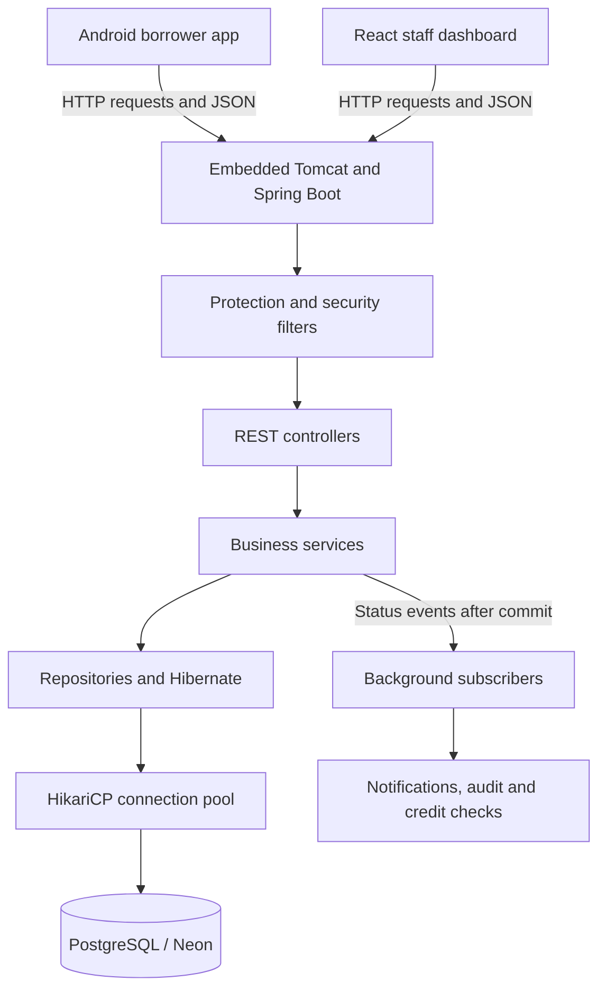

# Understanding your TrustBank Spring Boot backend

This guide is for your first Spring Boot project. It explains the code currently in this repository, how it handles data, and how to explore its API. Paths below are relative to the repository root unless a different base is stated.

Your backend uses **Java 21, Spring Boot 3.5.7, PostgreSQL, and springdoc-openapi 2.8.9**. The code compiles and its 18 unit tests pass. Neon is now connected, both migrations have applied, and the running API health and generated OpenAPI routes have been verified. Real credentials stay in ignored `backend/.env`.

## 1. What Spring Boot does

Java is the programming language. Spring provides tools for constructing an application: creating objects, connecting them, processing web requests, securing endpoints, and managing database transactions. Spring Boot assembles and configures those tools so the application can start from a Java `main` method.

You do not have to install a separate Tomcat server for this project. Its web dependency brings an embedded Tomcat server, and the application starts it when you run the backend.

Boot's auto-configuration uses the dependencies and settings you supply to configure infrastructure. Your explicit configuration can override the defaults. This is why adding a database dependency alone is insufficient: the connection settings still have to identify a working database. [Spring Boot auto-configuration reference](https://docs.spring.io/spring-boot/3.5/reference/using/auto-configuration.html).

The application entry point is:

`backend/src/main/java/com/trustbank/loanapp/LoanBackendApplication.java`

```java
@SpringBootApplication(exclude = UserDetailsServiceAutoConfiguration.class)
@ConfigurationPropertiesScan
public class LoanBackendApplication {
    public static void main(String[] args) {
        SpringApplication.run(LoanBackendApplication.class, args);
    }
}
```

`@SpringBootApplication` enables configuration and scanning for application components. The exclusion disables Spring's default user-details auto-configuration because this project supplies its own JWT authentication. `@ConfigurationPropertiesScan` discovers typed settings such as `AppProperties`.

## 2. Where the backend fits

The Android app and React dashboard are clients. They send HTTP requests to one backend, which applies business rules and reads or writes PostgreSQL. Neon is the hosted PostgreSQL service planned for this project.



This is a single backend application, often called a **layered monolith**. The layers are groups of responsibilities inside one running Java application. Audit, notifications and credit checks are components of that application, rather than separately deployed microservices.

## 3. Your folder map

Most Java code is under `backend/src/main/java/com/trustbank/loanapp/`:

| Folder | Responsibility | Start with |
|---|---|---|
| `web/` | Routes, request parameters, role restrictions and HTTP responses | `ApplicationController.java` |
| `web/dto/` | Shapes of incoming and outgoing JSON | `LoanDtos.java`, `AuthDtos.java`, `DtoMapper.java` |
| `service/` | Loan rules, account operations, calculations and transaction boundaries | `LoanApplicationService.java`, `LoanWorkflowService.java` |
| `domain/` | Database-mapped objects and business enums | `LoanApplication.java`, `LoanStatus.java` |
| `repo/` | Database access | `LoanApplicationRepository.java` |
| `security/` | JWT verification, current caller, rate/body protection | `JwtAuthFilter.java`, `RequestGuardFilter.java` |
| `idempotency/` | Duplicate-request detection and cached replies | `IdempotencyService.java` |
| `event/` | Events and background subscribers | `LoanStatusChangedEvent.java`, `AuditSubscriber.java` |
| `config/` | Security settings, worker pools, clock and development seed data | `SecurityConfig.java`, `AsyncConfig.java` |
| `common/` | Shared errors and exception-to-HTTP conversion | `ApiException.java`, `GlobalExceptionHandler.java` |

Other files you will use:

| Location | What it contains |
|---|---|
| `backend/pom.xml` | Maven dependencies, Java version and build plugins |
| `backend/src/main/resources/application.yml` | Runtime settings and development/production profiles |
| `backend/src/main/resources/db/migration/` | Versioned SQL migrations |
| `backend/src/test/java/` | Backend tests |
| `backend/mvnw.cmd` and `backend/mvnw` | Maven wrappers for Windows and Unix |

## 4. Controllers, services and repositories

A **controller** receives an HTTP request. It identifies the route, extracts inputs, invokes application logic, and returns a response. It should be easy to read without understanding SQL or interest calculations.

For example, `ApplicationController` declares:

```java
@RestController
@RequestMapping("/api/v1/applications")
```

An `@GetMapping` method in that class handles `GET /api/v1/applications`. Its `@PostMapping` method handles `POST /api/v1/applications`.

A **service** decides whether an operation is allowed and performs it. `LoanApplicationService.submit` checks that the loan product is active, the applicant has a profile, and the requested amount and term satisfy the product limits. It takes the interest rate from the product stored on the server.

A **repository** loads and stores entities. Your repository extends:

```java
public interface LoanApplicationRepository
        extends JpaRepository<LoanApplication, UUID> {
    // Application-specific queries are declared here.
}
```

`LoanApplication` is the entity type; `UUID` is its ID type. Spring Data supplies implementations of inherited operations such as `findById` and `save`.

Repository methods can also describe a query through their names. Your `findByApplicantIdOrderBySubmittedAtDesc` means: find applications belonging to this applicant and sort by submission time, newest first. Some methods use explicit queries instead; `nextReferenceNumber` executes PostgreSQL's `nextval` function.

## 5. How Spring connects the classes

Spring creates and manages application objects called **beans**. With constructor injection, a class declares the collaborators it needs, and Spring supplies them.

This is an excerpt from your controller:

```java
public ApplicationController(LoanApplicationService loans,
        RepaymentService repayments, IdempotencyService idempotency) {
    this.loans = loans;
    this.repayments = repayments;
    this.idempotency = idempotency;
}
```

The controller does not need to create those services with `new`. Spring finds the service beans and passes them into the constructor. Repositories are supplied in the same way.

Controllers and services normally have one shared instance in this application. Many request threads can call that instance. This is why borrower-specific values belong in method parameters and local variables, rather than fields such as `currentLoan` on a service.

## 6. How JSON becomes stored data

There are several different representations of the same business information:

| Representation | Example | Purpose |
|---|---|---|
| Request JSON | `{"amountRequested": 1000000}` | Data travelling over HTTP |
| Request DTO | `SubmitApplicationRequest` | Java input object with validation rules |
| Entity | `LoanApplication` | Object Hibernate maps to a database row |
| Database row | A row in `loan_applications` | Durable storage |
| Response DTO | `ApplicationDto` | Selected fields returned to the client |

**DTO** means Data Transfer Object. Your DTOs often use Java `record` declarations, which provide concise data containers. Jackson converts request JSON into these objects and converts response objects back into JSON.

An **entity** is a persistence object. In `LoanApplication.java`:

```java
@Entity
@Table(name = "loan_applications")
public class LoanApplication {
    // Database-mapped fields are declared here.
}
```

`@Column(name = "amount_requested")` connects the Java field to the SQL column. `@Id` identifies the primary key, and this project's `@GeneratedValue(strategy = GenerationType.UUID)` asks Hibernate to generate UUID identifiers. Lombok's `@Getter` and `@Setter` generate accessor methods during compilation.

**JPA** is the persistence API used by the code. **Hibernate** implements it and translates entity operations into SQL. **Spring Data JPA** supplies the repository layer above Hibernate. **JDBC** carries database operations through the PostgreSQL driver.

The entity is not returned directly from your controllers. `DtoMapper` constructs the response DTO. For example, `UserDto` has no password hash, and the borrower application view leaves out internal assignment information. That explicit mapping limits which database fields can reach a client.

### Data types you will notice

- Money and interest values use `BigDecimal` on the server for decimal arithmetic. Rounding still has to be chosen explicitly by calculations.
- IDs use `UUID`, while human-readable application references are separate strings such as `LN-2026-000001`.
- `Instant` represents moments such as submission and expiry; JSON timestamps normally include UTC's `Z` suffix.
- `LocalDate` represents dates without a time, such as a date of birth or repayment due date.
- Enums such as `LoanStatus` restrict values to named choices.
- Extra application details use a Java map stored as PostgreSQL `JSONB`; main searchable fields remain ordinary columns.

## 7. Follow one loan submission

Assume the borrower is registered, phone-verified, signed in, and has completed their KYC profile. They submit this illustrative request using a real product ID from `GET /api/v1/products`:

```http
POST /api/v1/applications
Authorization: Bearer <borrower-access-token>
Idempotency-Key: 82c0f4b7-c165-4a91-8270-8487fe44166a
Content-Type: application/json
```

```json
{
  "productId": "<replace-with-a-real-product-UUID>",
  "amountRequested": 1000000,
  "termMonths": 12,
  "purpose": "School fees for the coming term",
  "details": {}
}
```

The placeholder product ID must be replaced; it is not a valid UUID as written. The amount and term must also fit the selected product.

The request passes through these steps:

1. `RequestGuardFilter` checks protection rules, including request size and rate.
2. `JwtAuthFilter` verifies the token and establishes who is calling. Method security restricts submission to `BORROWER`.
3. Jackson reads the JSON into `SubmitApplicationRequest`. `@Valid` checks its declared constraints, such as positive amount and a purpose of 10-200 characters.
4. `ApplicationController.submit` passes the caller, key and request to `IdempotencyService`.
5. The idempotency service claims the request key in PostgreSQL. If it already belongs to the same completed request, it returns the cached response.
6. For a new request, `LoanApplicationService.submit` checks business rules and saves the application. `LoanStateMachine` records the initial status history and publishes a status event.
7. A response DTO is serialized into the reply cache. The key, application, history and cached reply participate in the same database transaction.
8. On successful commit, subscribers can record notifications and audit information. The controller returns the response DTO as JSON.

The first successful submission returns **201 Created**. A successful replay returns **200 OK** with `Idempotent-Replayed: true`. The first execution uses that header with `false`. Reusing the key with a different payload is refused. Keys currently have a configured 24-hour retention window, so this is a bounded retry guarantee.

For a read, the path is shorter: a controller calls a read service, a repository loads records, and DTOs become response JSON. Borrower queries are scoped to the caller's ID so they cannot simply request another person's loan.

## 8. Transactions, migrations and connections

### A transaction groups changes into one operation

`@Transactional` establishes a database transaction around a service operation when invoked through Spring's transaction infrastructure. With the default rules, an unhandled runtime exception causes rollback; successful completion allows commit. Several repository calls can therefore succeed or fail together. [Spring Data JPA transaction reference](https://docs.spring.io/spring-data/jpa/reference/3.5/jpa/transactions.html).

A transaction does not stay open for the lifetime of a loan. A loan may last months, while each submit, approval, repayment or other step uses a short transaction.

Within a transaction, Hibernate tracks changes to managed entities. A setter can therefore result in an SQL update at flush/commit even when there is no second `save` call. An explicit `flush()` sends pending SQL to the database earlier; it does **not** itself commit the transaction. Your staff workflow flushes before building a reply so the reply includes the updated version number.

`@Transactional(readOnly = true)` expresses read intent and can enable optimizations. It is not an authorization mechanism.

### Flyway controls the table structure

The migrations are:

- `V1__init_schema.sql`: tables, constraints, indexes and sequences.
- `V2__seed_loan_products.sql`: initial loan products.

Flyway applies migrations to the configured database and tracks them in its history table. With `spring.jpa.hibernate.ddl-auto: none`, Hibernate is not responsible for creating or updating your tables. For a schema change after deployment, add a new migration such as `V3__add_something.sql` rather than rewriting an already-applied migration.

Your tables cover users, verification codes, profiles, products, applications, status history, documents, credit checks, approvals, disbursements, repayment schedules, repayments, notifications, audit logs and idempotency records.

### HikariCP reuses database connections

The pool is configured for up to 10 database connections by default, with a 3-second wait to acquire one. Tomcat can handle up to 50 request threads by default, so a request thread is not the same thing as a database connection. Database lock and statement timeouts provide additional bounded waits. These settings are in `application.yml`.

## 9. Conflicts, deadlines and background work

**Optimistic locking:** `LoanApplication` has an `@Version` field. Staff commands send the version they last read. If another request changes the record first, a stale command is refused with `409 VERSION_CONFLICT`. The client reloads the record before the officer decides what to do next. This prevents silent overwrites; short database locks during updates can still occur.

**Firm deadlines:** the default OTP lifetime is five minutes and the offer acceptance window is 72 hours. The server checks expiry timestamps, including rejection exactly at expiry. A phone's countdown is a display aid; changing its clock does not extend the server's deadline.

**Workflow:** `LoanStatus` defines legal transitions. A typical successful path is:

```text
SUBMITTED -> CREDIT_CHECK_PENDING -> CREDIT_CHECK_PASSED -> UNDER_REVIEW
-> APPROVED -> PENDING_DISBURSEMENT -> DISBURSED -> ACTIVE -> CLOSED
```

Other paths cover missing documents, additional information, rejection, delinquency and default.

**Events:** `LoanStateMachine` publishes `LoanStatusChangedEvent`. Independent subscribers respond after the transaction commits, so a rolled-back approval should not generate a success notification. Audit and notification writes use their own transactions.

`CreditCheckWorker` separates its work into a short database read, a slow bureau call without a held database transaction, then a short database write. `@Async` normally runs that work on the configured background pool. If the bounded queue saturates, its `CallerRunsPolicy` can run work on the submitting thread. Events are in process and are not a durable message queue; a crash can lose an unprocessed side effect.

## 10. Login and errors

Registration stores a BCrypt password hash and issues a verification code. A borrower must verify their phone before login succeeds. Login checks the credentials and returns a signed JWT access token, with a default lifetime of 60 minutes.

Protected calls then include:

```http
Authorization: Bearer <accessToken>
```

The server uses the token to identify the caller on each request. It does not maintain a login session in server memory. This statelessness concerns login/session handling; business records remain stored in PostgreSQL.

Roles control access to actions. `@PreAuthorize("hasRole('BRANCH_MANAGER')")`, for example, restricts a method to managers. An administrator does not automatically inherit every other role's permissions: the actual annotations determine access.

Expected failures become a consistent JSON error through `GlobalExceptionHandler` or the security filters. For example:

```json
{
  "timestamp": "2026-11-13T09:00:00Z",
  "status": 409,
  "code": "VERSION_CONFLICT",
  "message": "This record was changed by someone else. Reload it and try again.",
  "path": "/api/v1/applications/<id>/decision",
  "currentVersion": 4
}
```

`currentVersion` is available for the explicit stale-version check; a race detected later by Hibernate can return the conflict without that field.

| Status | Common meaning in this backend |
|---|---|
| 400 | Malformed input, missing required header, or DTO validation failure |
| 401 | Missing/invalid authentication or incorrect login credentials |
| 403 | Role restriction, unverified borrower login, or HTTPS requirement |
| 404 | Record unavailable to this caller, or unknown route |
| 409 | Version conflict or another data conflict |
| 410 | OTP or offer deadline expired |
| 413 | Request body exceeds the configured limit |
| 422 | Business rule violation, including a reused key with changed content |
| 429 | Rate limit or OTP attempt limit |
| 503 | Database resources unavailable or bounded wait exceeded |

## 11. Yes: your project includes Swagger documentation

There are three related names:

- **OpenAPI** is the structured description of routes, inputs, outputs and authentication conventions.
- **springdoc-openapi** inspects Spring controllers and Java types to generate that description.
- **Swagger UI** displays it as an interactive website where you can browse operations and send requests. [springdoc documentation](https://springdoc.org/).

Your `pom.xml` already includes `springdoc-openapi-starter-webmvc-ui`. `application.yml` configures these addresses:

| Address when running locally | What you get |
|---|---|
| [Swagger UI](http://localhost:8080/swagger-ui.html) | Interactive API explorer; it may redirect to the UI's index page |
| [OpenAPI JSON](http://localhost:8080/v3/api-docs) | Machine-readable API specification, also suitable for import into API tools |
| [Health endpoint](http://localhost:8080/actuator/health) | A server health response; this is separate from API documentation |

These URLs refer to a server on your own computer. They work **after PostgreSQL is configured and the backend successfully starts**. A successful `mvnw test` or compilation does not start a long-running API server.

### What is configured, and what needs improvement?

| Capability | Current code status |
|---|---|
| Automatic route and DTO discovery | Dependency installed |
| Swagger UI and OpenAPI paths | Configured and allowed through the authentication rules |
| Public operations such as login | Available to explore without a token once the server runs |
| Swagger bearer-token scheme and security requirements | Not explicitly configured yet |
| Detailed operation summaries, examples, roles and business-error responses | Not comprehensively annotated yet |
| Runtime verification of generated docs | Verified locally against Neon: 25 paths generated |

Swagger will help you understand the **API contract**. It does not automatically explain every service rule, transaction, table relationship or background worker. Use this guide alongside it. Java comments in the source also do not automatically become complete API descriptions with the current dependencies.

### How to explore it for the first time

1. Follow `DEPLOYMENT.md` to configure the database environment.
2. From `backend/`, start the server with `.\mvnw.cmd spring-boot:run` in PowerShell. Wait for startup to complete; inspect any database or migration error if it fails.
3. Open Swagger UI and expand the authentication controller's `POST /api/v1/auth/login` operation.
4. Read the request schema, select **Try it out**, supply the JSON below, and select **Execute**. These credentials exist only when the development seeder is enabled and has run successfully.

```json
{
  "email": "grace.officer@bankloan.ug",
  "password": "Passw0rd1"
}
```

5. Inspect the HTTP status, returned JSON and generated request example. Login should return `accessToken`, `tokenType`, `expiresIn` and `user`.
6. Expand **Schemas** to study DTO fields and enum values. Examples and inferred response codes are documentation aids; the actual controller and service rules still apply.

The current code does not define Swagger's JWT bearer scheme, so do not assume an **Authorize** button will attach the token to protected operations. The backend itself accepts bearer tokens. Until its OpenAPI security metadata is added, use an API client or the PowerShell example below for authenticated exploration.

```powershell
$apiBase = 'http://localhost:8080'
$loginBody = @{
    email = 'grace.officer@bankloan.ug'
    password = 'Passw0rd1'
} | ConvertTo-Json

$loginReply = Invoke-RestMethod -Method Post `
    -Uri "$apiBase/api/v1/auth/login" `
    -ContentType 'application/json' -Body $loginBody

$apiHeaders = @{ Authorization = "Bearer $($loginReply.accessToken)" }
Invoke-RestMethod -Uri "$apiBase/api/v1/me" -Headers $apiHeaders
Invoke-RestMethod -Uri "$apiBase/api/v1/products" -Headers $apiHeaders
Invoke-RestMethod -Uri "$apiBase/api/v1/applications" -Headers $apiHeaders
```

These last three operations read data. Swagger's **Execute** sends real requests too: a POST can create or change development records.

### What a fuller Swagger setup should add

A future documentation configuration should declare an HTTP bearer scheme with JWT format, apply its security requirement to protected operations, and leave public authentication operations unrestricted in the specification. Once configured, Swagger UI's Authorize control can accept the token and send the `Authorization: Bearer ...` header. Authentication enforcement still belongs to Spring Security. [Swagger bearer-authentication reference](https://swagger.io/docs/specification/v3_0/authentication/bearer-authentication/).

Endpoint annotations should also explain roles, valid workflow states, `Idempotency-Key`, version fields, deadline behavior, and error responses. `@CurrentUser` is populated by the server from authentication; clients must not be asked to supply an `AuthUser` object. Verify that parameter is hidden in the generated specification.

Those are proposed improvements, not changes made by this guide.

## 12. Endpoints to learn first

This is a learning route through the API, rather than a complete endpoint catalog. IDs are real record UUIDs, and protected operations need the correct caller role.

| Operation | Purpose | Caller |
|---|---|---|
| `POST /api/v1/auth/register` | Create borrower account and issue OTP | Public |
| `POST /api/v1/auth/otp/verify` | Confirm OTP | Public |
| `POST /api/v1/auth/login` | Obtain access token | Public |
| `GET /api/v1/me` | Inspect the authenticated account | Signed-in user |
| `PUT /api/v1/me/profile` | Save borrower KYC details | Borrower |
| `GET /api/v1/products` | List loan products | Signed-in user |
| `POST /api/v1/applications` | Submit a loan with an idempotency key | Borrower |
| `GET /api/v1/applications/{id}` | Read application detail | Owner or staff |
| `POST /api/v1/applications/{id}/assign` | Pick up an application, with a version | Loan officer |
| `POST /api/v1/applications/{id}/decision` | Approve/reject an application under review | Branch manager |
| `POST /api/v1/applications/{id}/offer/accept` | Accept an unexpired offer, with a key | Borrower |
| `POST /api/v1/applications/{id}/disbursement` | Record disbursement, with a key and version | Branch manager |
| `GET /api/v1/applications/{id}/schedule` | Read calculated repayment schedule | Owner or staff |
| `POST /api/v1/applications/{id}/repayments` | Record repayment, with a key | Borrower |
| `GET /api/v1/audit-logs` | Inspect recorded actions | Administrator |

You cannot approve a freshly submitted application immediately. It must follow the workflow through credit checks and review. `backend/scripts/smoke-test.sh` demonstrates a longer sequence once the API and database are running.

## 13. The annotations you will keep seeing

| Annotation | How to read it |
|---|---|
| `@RestController` | This class handles web requests and returns response data. |
| `@RequestMapping`, `@GetMapping`, `@PostMapping` | These declare URL paths and HTTP methods. |
| `@RequestBody` | Read this Java object from the request's JSON body. |
| `@PathVariable` | Read a value from the URL path, such as `{id}`. |
| `@RequestParam` | Read a query-string value, such as `?limit=20`. |
| `@RequestHeader` | Read an HTTP header, such as `Idempotency-Key`. |
| `@Valid`, `@NotNull`, `@Positive` | Validate incoming values against declared constraints. |
| `@Service`, `@Component` | Register application objects for Spring to manage. |
| `@Configuration`, `@Bean` | Declare configuration and objects Spring should provide. |
| `@Entity`, `@Table`, `@Column` | Describe how an object maps to database storage. |
| `@Version` | Track a row version for optimistic concurrency checks. |
| `@Transactional` | Define a database transaction boundary through Spring. |
| `@PreAuthorize` | Check whether the caller may invoke this method. |
| `@CurrentUser` | Inject this project's authenticated caller from the JWT context. |
| `@Async` | Invoke through a configured background executor. |
| `@TransactionalEventListener` | Handle an event at a transaction phase, usually after commit here. |
| `@Scheduled` | Run periodic jobs, such as expiring offers. |
| `@RestControllerAdvice` | Supply shared exception handling for controllers. |

## 14. How to read and change this backend

Start with one operation, such as listing applications. Read its controller method, follow the service call, inspect the repository query, then compare the entity with the response DTO. This connects a URL you can try to the actual code and database fields behind it.

For a new feature, use this order:

1. Decide the request/response DTOs and validation rules.
2. Put business rules and transaction boundaries in a service.
3. Add repository access and an entity change if needed.
4. Add a new Flyway migration if the stored schema changes.
5. Expose the operation through a controller with appropriate authorization.
6. Document its inputs, roles, success and failure cases in OpenAPI metadata.
7. Add focused tests for the behavior and verify against PostgreSQL when the feature depends on database behavior.

Use `.\mvnw.cmd test` from `backend/` for backend unit tests. Use `.\mvnw.cmd spring-boot:run` to run the API. Use `.\mvnw.cmd package` to build a deployable jar. The wrappers use `JAVA_HOME`, so it should point to Java 21 for this backend. See `DEPLOYMENT.md` for environment variables and the next database setup stage.

Remember the present implementation limits while exploring: document bytes are stored in MongoDB Atlas GridFS (see [setup](../backend/GRIDFS-SETUP.md)); SMS, credit-bureau access and payment settlement are demo integrations. Database configuration will make the stored workflow usable, but it will not turn those stubs into external services.
