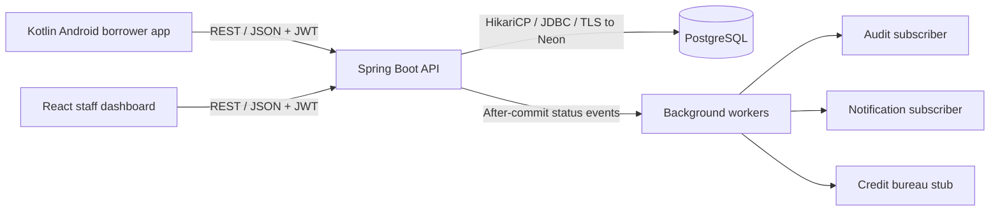

# Tasks.pdf implementation coverage

Source: `docs/Tasks.pdf`, especially technical requirements on pages 4-5. Its embedded project prompt is treated as coursework requirements. The current work is the user's requested repository merge and code verification; database provisioning follows separately.

## Architecture

Presentation and light validation run in the clients. Loan eligibility, interest, transitions and authorization run on the server. PostgreSQL owns durable records and concurrency constraints.

## Six required concepts

| Requirement | Implementation evidence (relative to repository root) | Verification |
|---|---|---|
| 1. Three-tier cooperative processing | `mobile/app/.../util/Validators.kt`, `web/src/lib/schemas.ts`; server `service/CreditScoringService.java`, `AmortizationCalculator.java`, `LoanWorkflowService.java`; PostgreSQL migrations | Android debug APK and web production builds pass; backend maths/workflow tests pass. |
| 2. Authentication, authorization, TLS, privacy, protection | Backend `security/JwtService.java`, `JwtAuthFilter.java`, `config/SecurityConfig.java`; controller `@PreAuthorize`; borrower ownership-scoped queries; `web/dto/DtoMapper.java`; `security/RequestGuardFilter.java`; production HTTPS guard and deploy nginx templates | Backend compiles; request limit/rate tests pass. Role refusal was checked against the running Neon API; hosted TLS remains to verify. |
| 3. Stateless server and at-most-once invocations | `SessionCreationPolicy.STATELESS`; `idempotency/IdempotencyService.java` and `repo/IdempotencyRecordRepository.java`; unique `(user_id, idem_key)`, request hash and cached JSON response in the same transaction as the business change; submit, accept, disburse and repay controllers; Kotlin keys/retries; React `src/api/client.ts` and disbursement key | Unit test proves reply replay without a second action and rejects changed payloads. Concurrent duplicate submissions were verified against Neon, including retry/cached replies. Rollback/crash recovery remains to test. Lock/connection failures return HTTP 503 for safe client retries. Keys have a configured 24-hour retention window. |
| 4. Thread pools, thread safety, delayed concurrency | `application.yml`: bounded Tomcat and HikariCP pools/timeouts; request data stays local in services/controllers; `config/AsyncConfig.java`; `event/CreditCheckWorker.java` does slow bureau I/O between short transactions | Source reviewed and compiled; duplicate-submit and manager-decision races were exercised against Neon. Load testing remains pending. No borrower business state is stored in singleton service fields. |
| 5. REST request/reply and publish/subscribe | DTOs and OpenAPI; Retrofit `data/remote/LoanApi.kt`; `LoanStateMachine` publishes `LoanStatusChangedEvent`; independent asynchronous after-commit audit, notification and credit subscribers | Backend/web compile. Events cover approval and rejection through the generic status event; the PDF's suggested event name is not a separate required class. The running credit worker, persisted borrower notifications and audit rows were verified against Neon. |
| 6. Firm deadlines, optimistic locking, indexes | `OtpService.verify`, `LoanApplicationService.acceptOffer` reject at or after expiry; `@Version` on loan/document/schedule entities; staff commands carry versions; global error handler maps conflicts to 409; queue, applicant, offer and unpaid-installment indexes in V1 migration | Exact-expiry OTP/offer and stale-version unit tests pass. Concurrent manager transactions were verified against Neon (one success, one 409). Index execution plans and HTTP deadline expiry still need dedicated checks. |

Backend Java paths above are under `backend/src/main/java/com/trustbank/loanapp/`; migrations are under `backend/src/main/resources/db/migration/`.

## Requested deliverables

1. Architecture and concept mapping: this file.
2. PostgreSQL DDL: `V1__init_schema.sql`; product seed: `V2__seed_loan_products.sql`. The PDF's `loans` and `audit_events` correspond to the existing domain names `loan_applications` and `audit_logs`; no duplicate tables are needed.
3. Spring Boot implementation: `backend/` (entities, repositories, transactional services, subscribers, controllers and tests).
4. Client integration: complete Kotlin Retrofit implementation in `mobile/app/.../data/remote/` and React HTTP adapters in `web/src/api/http/`. `ApplicationDetailPage.tsx` handles 409 conflicts by reloading and informing staff.

The PDF's CLIENT role maps to BORROWER. Its OFFICER role is split into LOAN_OFFICER, CREDIT_ANALYST, BRANCH_MANAGER and ADMIN for least-privilege staff actions.

## Follow-up verification

Neon configuration, both migrations, API health, Swagger and the complete Python smoke workflow are now verified. The following checklist also covers deeper checks that remain outstanding.

1. Start with a fresh development PostgreSQL database; let Flyway create the tables and products.
2. Run `backend/scripts/smoke-test.sh` against the dev API. It creates test records and verifies registration/OTP, repeated loan submission, credit worker, stale decision, repeated disbursement, repayment and role refusal.
3. Add/run concurrent transaction tests: duplicate submissions with the same key; simultaneous decisions on one version; rollback before reply caching; late offer and OTP requests through HTTP.
4. Run both clients against the real API and walk one loan to closure. Confirm audit and notification rows appear after commits.
5. Check query plans and production HTTPS/Neon TLS configuration before deployment.

## Practical limits

SMS, the credit bureau and payment settlement are stubs; documents store metadata only. Tokens and pending verification in Android are in memory. In-process events are not durable across a server crash; an outbox is future work. When the bounded async queue saturates, CallerRunsPolicy can execute work on the publishing thread; normal asynchronous behavior is not a hard latency guarantee. The rate limiter is per server instance. These limits are recorded rather than presented as tested production capabilities.
