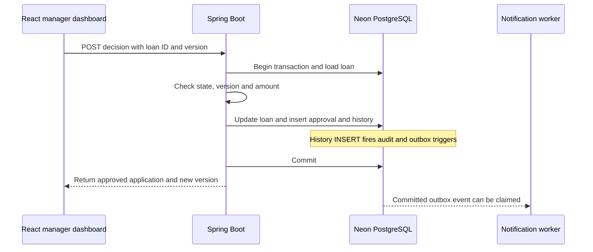

# Transactions and ACID in TrustBank

A database transaction groups operations into one unit of work. TrustBank uses short PostgreSQL transactions for steps such as submitting an application, approving an offer, and recording a disbursement. A borrower’s loan journey can span days. Each request commits its own step, and the database keeps the state needed for the next request. [PostgreSQL transactions](https://www.postgresql.org/docs/18/tutorial-transactions.html)

## The four properties

| Property | Meaning | Example in TrustBank |
| --- | --- | --- |
| Atomicity | The changes in one transaction commit or roll back together. | Approving a loan writes its status, approval, status history, audit row and outbox row together. A failure rolls them back together. |
| Consistency | A committed change preserves the rules the system enforces. | Java checks the current state and product amount limits. PostgreSQL uses foreign keys, unique constraints and checks such as `amount_paid <= amount_due`. |
| Isolation | Concurrent transactions see and affect each other according to the isolation level. | Under PostgreSQL’s default Read Committed level, a normal query sees committed data as of the start of that query. Hibernate’s version check prevents two managers from successfully saving a decision based on the same loan version. |
| Durability | A committed change survives a process restart. | Neon retains the committed decision and outbox row after the Spring Boot process restarts, so the notification worker can pick up pending work. |

Read Committed can show a later commit to a second query in the same transaction. TrustBank uses version checks and constraints for the specific races that matter to the workflow. [PostgreSQL isolation levels](https://www.postgresql.org/docs/18/transaction-iso.html)

## Files to open

| File | Responsibility |
| --- | --- |
| [`mobile/app/src/main/java/com/trustbank/loanapp/data/remote/LoanApi.kt`](../../mobile/app/src/main/java/com/trustbank/loanapp/data/remote/LoanApi.kt#L60) | Sends the application request with an `Idempotency-Key`. |
| [`backend/src/main/java/com/trustbank/loanapp/web/ApplicationController.java`](../../backend/src/main/java/com/trustbank/loanapp/web/ApplicationController.java#L57) | Requires the borrower role, validates the submitted data and delegates the create command. |
| [`backend/src/main/java/com/trustbank/loanapp/idempotency/IdempotencyService.java`](../../backend/src/main/java/com/trustbank/loanapp/idempotency/IdempotencyService.java#L70) | Opens the transaction that claims the key, runs the business operation and saves the response. |
| [`backend/src/main/java/com/trustbank/loanapp/repo/IdempotencyRecordRepository.java`](../../backend/src/main/java/com/trustbank/loanapp/repo/IdempotencyRecordRepository.java#L22) | Uses an atomic SQL insert to claim the key. |
| [`backend/src/main/java/com/trustbank/loanapp/service/LoanApplicationService.java`](../../backend/src/main/java/com/trustbank/loanapp/service/LoanApplicationService.java#L92) | Checks the borrower’s profile and product limits, then saves the loan and submits its first state change. |
| [`backend/src/main/java/com/trustbank/loanapp/web/StaffWorkflowController.java`](../../backend/src/main/java/com/trustbank/loanapp/web/StaffWorkflowController.java#L82) | Exposes the manager-only decision and disbursement routes. |
| [`backend/src/main/java/com/trustbank/loanapp/service/LoanWorkflowService.java`](../../backend/src/main/java/com/trustbank/loanapp/service/LoanWorkflowService.java#L234) | Runs the approval or rejection as a single transaction. |
| [`backend/src/main/java/com/trustbank/loanapp/service/LoanStateMachine.java`](../../backend/src/main/java/com/trustbank/loanapp/service/LoanStateMachine.java#L43) | Checks the transition, changes the status and saves the history row. |
| [`backend/src/main/java/com/trustbank/loanapp/domain/LoanStatus.java`](../../backend/src/main/java/com/trustbank/loanapp/domain/LoanStatus.java#L19), [`backend/src/main/java/com/trustbank/loanapp/domain/LoanApplication.java`](../../backend/src/main/java/com/trustbank/loanapp/domain/LoanApplication.java#L90) | Define permitted transitions and the version field Hibernate uses for optimistic concurrency. |
| [`backend/src/main/java/com/trustbank/loanapp/service/DisbursementService.java`](../../backend/src/main/java/com/trustbank/loanapp/service/DisbursementService.java#L52), [`backend/src/main/java/com/trustbank/loanapp/service/RepaymentService.java`](../../backend/src/main/java/com/trustbank/loanapp/service/RepaymentService.java#L49) | Apply the same transaction principle to disbursement and repayment. |
| [`backend/src/main/resources/db/migration/V1__init_schema.sql`](../../backend/src/main/resources/db/migration/V1__init_schema.sql#L165), [`backend/src/main/resources/db/migration/V5__durable_loan_messaging.sql`](../../backend/src/main/resources/db/migration/V5__durable_loan_messaging.sql#L21) | Define relational constraints and the triggers that add audit and outbox records. |

## Key code for approval and concurrency

The approval method starts a Spring-managed transaction on entry from the controller. These lines show the transaction boundary and the first two guards.

```java
@Transactional
public ApplicationDto decide(AuthUser manager, UUID applicationId, DecisionRequest request) {
    LoanApplication application = load(applicationId);
    stateMachine.requireVersion(application, request.version());
    if (application.getStatus() != LoanStatus.UNDER_REVIEW) {
        throw ApiException.rule("NOT_UNDER_REVIEW", "Only applications under review can be decided");
    }
```

`requireVersion` checks the version sent in the request against the version freshly loaded by the service. The state guard only accepts decisions while the application is `UNDER_REVIEW`. On approval, lines 251–261 validate the amount, save the approved amount and expiry time on the application, and request the `APPROVED` transition. The method then saves a separate `Approval` record and calls `reply(application)`. That helper flushes changes so the returned version reflects the database update.

Hibernate uses the entity’s `@Version` field as a second check at the actual write. If two managers both pass the first check at version 4, the first successful update advances the version. The other update still expects version 4, affects zero rows and raises an optimistic locking failure. Spring rolls back that transaction and the API maps the conflict to HTTP 409. The SQL below is illustrative. [Entity version field](../../backend/src/main/java/com/trustbank/loanapp/domain/LoanApplication.java#L90) · [HTTP conflict mapping](../../backend/src/main/java/com/trustbank/loanapp/common/GlobalExceptionHandler.java#L43)

```sql
UPDATE loan_applications
SET status = 'APPROVED', version = version + 1
WHERE id = :loan_id AND version = :expected_version;
```

**Flush and commit are separate.** JPA is the Java persistence API that Hibernate implements. A flush sends pending statements to PostgreSQL, so constraints and triggers can run then. Commit makes the transaction permanent. If the transaction later fails, a successful flush can still be rolled back. Spring commits on normal completion and ordinarily rolls back on unchecked exceptions.

## End-to-end approval flow



A request that fails a guard or loses the version race leaves no successful approval, history, audit or outbox row from that request. Once a request commits, the worker can send the notification even if the HTTP reply is lost. The subsequent delivery uses separate transactions and can finish independently of the HTTP response.

## Retrying a borrower submission

The borrower calls `POST /api/v1/applications` with a key and request body. The controller wraps `loans.submit(...)` in `IdempotencyService.execute(...)`. Spring’s default `REQUIRED` propagation lets the loan service join the outer transaction. The repository’s claim uses `ON CONFLICT (user_id, idem_key) DO NOTHING` against a unique constraint, so the first request gets the claim and matching retries can replay its result.

```java
// First time: do the work. If it throws, the whole transaction (key row included) rolls back.
T reply = action.get();
records.storeReply(userId, key, HttpStatus.CREATED.value(), toJson(reply));
return new IdempotentResult<>(reply, false);
```

- **First request.** The key claim, loan insert, submission history, trigger rows and cached reply commit together. If the action throws, the key claim rolls back too.
- **Same key and same payload.** The service reads the recorded result and returns it with `Idempotent-Replayed: true`. It copies the prior outcome without creating another application.
- **Same key, different operation or payload.** The operation and request hash fail the equality check. The API returns HTTP 422 with `IDEMPOTENCY_KEY_REUSED`. The implementation has a configured 24-hour key TTL and deletes expired records through housekeeping.

## Disbursement and the transaction boundary

A manager posts `/api/v1/applications/{id}/disbursement` with a version and an idempotency key. The service requires an accepted offer in `PENDING_DISBURSEMENT`, creates the disbursement and repayment schedule, and records `DISBURSED` followed by `ACTIVE` in the same transaction. PostgreSQL’s `UNIQUE (loan_application_id)` on `disbursements` provides an additional safeguard against duplicate disbursement records. The current system records a simulated settlement. No real transfer provider participates in that database transaction. [Disbursement code](../../backend/src/main/java/com/trustbank/loanapp/service/DisbursementService.java#L52) · [Unique constraint](../../backend/src/main/resources/db/migration/V1__init_schema.sql#L175)

Document upload spans two stores. PostgreSQL holds file metadata and MongoDB GridFS holds the bytes. If PostgreSQL rolls back after an upload, `DocumentService` attempts to delete the uploaded file as compensation. That compensation has its own failure modes because the two databases have separate commit boundaries. [Upload and rollback cleanup](../../backend/src/main/java/com/trustbank/loanapp/service/DocumentService.java#L50)

## Presentation walkthrough

1. Open `LoanWorkflowService.decide(...)` and point to `@Transactional`, the state check and the version check.
2. Follow `stateMachine.move(...)` to `history.save(row)` and show the two trigger definitions in V5. Ask which rows remain if the transaction rolls back. The answer is that the proposed decision and all its derived rows are discarded.
3. Open `DisbursementService.disburse(...)` and show why a disbursement row and its installments belong together.
4. For evidence, open `rollbackRemovesHistoryAuditAndOutboxTogether` and the idempotency replay test. [PostgreSQL rollback test](../../backend/src/test/java/com/trustbank/loanapp/messaging/LoanMessagingIntegrationTest.java#L91) · [Lost-reply test](../../backend/src/test/java/com/trustbank/loanapp/idempotency/IdempotencyServiceTest.java#L15)

**Likely question. Why use both a version and an idempotency key?** A version detects competing changes based on stale data. An idempotency key tracks retries of a particular request, including cases where the first request succeeded but its reply never reached the client.

**Likely question. Does the database keep one transaction open until the borrower repays?** Each submission, decision, acceptance and repayment has its own short transaction. The loan’s committed status connects those transactions across the business workflow.

[Message Oriented Middleware](02-MESSAGE-ORIENTED-MIDDLEWARE.md) · [Stored procedures](03-STORED-PROCEDURES.md) · [Triggers](04-TRIGGERS.md)
