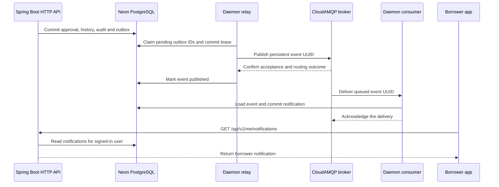

# Message Oriented Middleware in TrustBank

Message Oriented Middleware, or MOM, lets software components communicate by sending messages through a broker. TrustBank uses it for borrower notifications. A manager can approve a loan through HTTP, while a separate Spring Boot worker publishes and consumes the committed event. The client reads the resulting in-app notification through the REST API.

The application uses Spring AMQP and the RabbitMQ Java client. The hosted broker identifies itself as **LavinMQ** on CloudAMQP. LavinMQ implements AMQP 0-9-1, which is the protocol our client uses. The API runs on Vercel and the worker runs as the `loan-notifications` Vercel Daemon. PostgreSQL on Neon holds the outbox and final notifications. [LavinMQ protocol support](https://lavinmq.com/documentation/amqp-the-protocol) · [Vercel Daemons](https://vercel.com/docs/daemons)

## Files to open

| File | Responsibility |
| --- | --- |
| [`backend/pom.xml`](../../backend/pom.xml#L47), [`backend/src/main/resources/application.yml`](../../backend/src/main/resources/application.yml#L52) | Add the AMQP dependency and configure connection, confirmations, routing returns, ACKs and retries. |
| [`backend/src/main/resources/db/migration/V5__durable_loan_messaging.sql`](../../backend/src/main/resources/db/migration/V5__durable_loan_messaging.sql#L3) | Creates the durable outbox and the trigger that saves a message event with loan status history. |
| [`backend/src/main/java/com/trustbank/loanapp/messaging/LoanMessageStore.java`](../../backend/src/main/java/com/trustbank/loanapp/messaging/LoanMessageStore.java#L22) | Claims rows, loads the event, records publication and invokes the notification procedure. |
| [`backend/src/main/java/com/trustbank/loanapp/messaging/LoanOutboxRelay.java`](../../backend/src/main/java/com/trustbank/loanapp/messaging/LoanOutboxRelay.java#L26) | Scheduled publisher that checks for pending events and handles failed publication. |
| [`backend/src/main/java/com/trustbank/loanapp/messaging/RabbitMessagingConfig.java`](../../backend/src/main/java/com/trustbank/loanapp/messaging/RabbitMessagingConfig.java#L17) | Creates the exchange, notification queue, routing bindings and dead-letter queue. |
| [`backend/src/main/java/com/trustbank/loanapp/messaging/RabbitLoanPublisher.java`](../../backend/src/main/java/com/trustbank/loanapp/messaging/RabbitLoanPublisher.java#L22) | Sends the event UUID as a persistent message and checks the broker’s confirmation. |
| [`backend/src/main/java/com/trustbank/loanapp/messaging/RabbitNotificationConsumer.java`](../../backend/src/main/java/com/trustbank/loanapp/messaging/RabbitNotificationConsumer.java#L17) | Receives and parses the UUID, then calls the notification processor. |
| [`backend/src/main/java/com/trustbank/loanapp/messaging/NotificationProcessor.java`](../../backend/src/main/java/com/trustbank/loanapp/messaging/NotificationProcessor.java#L15), [`backend/src/main/java/com/trustbank/loanapp/messaging/NotificationText.java`](../../backend/src/main/java/com/trustbank/loanapp/messaging/NotificationText.java#L8) | Load the stored event and choose the notification text for its target status. |
| [`backend/src/main/java/com/trustbank/loanapp/web/MeController.java`](../../backend/src/main/java/com/trustbank/loanapp/web/MeController.java#L66), [`backend/src/main/java/com/trustbank/loanapp/service/AccountService.java`](../../backend/src/main/java/com/trustbank/loanapp/service/AccountService.java#L116) | Return the signed-in user’s notifications, newest first. |
| [`backend/src/main/java/com/trustbank/loanapp/messaging/MessagingController.java`](../../backend/src/main/java/com/trustbank/loanapp/messaging/MessagingController.java#L29), [`backend/vercel.json`](../../backend/vercel.json#L4) | Expose admin-only delivery status and recovery, and define the persistent cloud worker. |

## End-to-end flow



The ordered example shows a normal delivery. The consumer can finish quickly enough that `consumed_at` is assigned before the relay writes `published_at`. Those columns describe separate stages.

1. The request saves a loan status change and history row. A trigger writes one row to `loan_message_outbox`, a database table holding events that need delivery. The transaction commits both. If it rolls back, the event never becomes available to the relay.
2. The daemon checks the outbox every five seconds after the preceding poll finishes. `store.claim(token)` uses a short transaction to take up to ten rows. Once it returns, the relay has committed that claim and can call the broker without holding those row locks.
3. The publisher sends a text UUID to the **direct exchange** `trustbank.loan.events.v1` with routing key `loan.status.changed`. A direct exchange delivers to queues with a matching binding key. The durable queue `trustbank.loan.notifications.v1` holds the message for a consumer. The UUID refers to the full event stored in PostgreSQL.
4. The consumer reads the event and stores the notification in a new database transaction. For `APPROVED`, the text tells the borrower to accept the offer before it expires. Some internal statuses produce no text and the procedure still marks the event consumed.
5. The borrower’s app fetches `GET /api/v1/me/notifications`. The server gets the user ID from authentication and uses it to query notifications. The current path delivers **in-app notifications**. [Android API interface](../../mobile/app/src/main/java/com/trustbank/loanapp/data/remote/LoanApi.kt)

## Publisher and consumer code

The relay uses the lease token when acknowledging a claim in PostgreSQL. An older worker cannot mark a row complete once another relay has taken its lease. [Lease and completion SQL](../../backend/src/main/java/com/trustbank/loanapp/messaging/LoanMessageStore.java#L50)

```java
@Scheduled(fixedDelayString = "PT5S", initialDelayString = "PT10S")
public void scheduledPublish() {
    if (worker) publishBatch();
}

public int publishBatch() {
    UUID token = UUID.randomUUID();
    var messages = store.claim(token); // transaction finishes before network I/O
    int sent = 0;
    for (var message : messages) {
        UUID id = message.id();
        try {
            publisher.publish(message);
            store.complete(id, token); // only after publisher confirm AND successful routing
            sent++;
        } catch (InterruptedException ex) {
            Thread.currentThread().interrupt();
            break; // remaining leases expire; another worker recovers them
        } catch (Exception ex) {
            store.retryLater(id, token);
            log.warn("Loan message {} will retry ({})", id, ex.getClass().getSimpleName());
        }
    }
    return sent;
}
```

The publisher marks the message persistent and waits up to five seconds for a **publisher confirm**. A positive confirm together with no routing return lets the relay record `published_at`. The mandatory flag makes an unroutable message return to the producer, so a broker ACK alone is insufficient.

```java
public void publish(LoanMessageStore.ClaimedMessage message) throws Exception {
    UUID id = message.id();
    var properties = new MessageProperties();
    properties.setMessageId(id.toString());
    properties.setContentType(MessageProperties.CONTENT_TYPE_TEXT_PLAIN);
    properties.setDeliveryMode(MessageDeliveryMode.PERSISTENT);
    var correlation = new CorrelationData(id.toString());
    rabbit.send(RabbitMessagingConfig.EXCHANGE, message.type().routingKey,
            new Message(id.toString().getBytes(StandardCharsets.UTF_8), properties), correlation);
    var confirm = correlation.getFuture().get(5, TimeUnit.SECONDS);
    if (!confirm.isAck() || correlation.getReturned() != null) {
        throw new IllegalStateException("Broker did not accept and route the loan message");
    }
}
```

The consumer’s **acknowledgment** has a different job. It tells the broker the consumer handled the delivery. Spring’s `auto` mode acknowledges after the listener returns successfully. Because `NotificationProcessor.consumeStatusFromBroker(...)` is on a separate transactional bean, its database commit completes before the outer listener returns. [Publisher confirms and consumer ACKs](https://www.rabbitmq.com/docs/confirms)

```java
@RabbitListener(queues = RabbitMessagingConfig.QUEUE,
        autoStartup = "${app.messaging.worker-enabled:false}")
public void consume(Message message) {
    processor.consumeStatusFromBroker(eventId(message));
}
```

## Failure and recovery

| Situation | What happens |
| --- | --- |
| Broker fails or the publish is returned | The relay clears its lease and delays eligibility by 30 seconds. The durable outbox row remains available for retry. |
| Worker stops after claiming a row | The claim expires after 120 seconds. A later worker can claim the row again. |
| Broker accepts the message but the relay stops before updating PostgreSQL | The same event UUID may be published again. The notification procedure checks `consumed_at` and the notification table has a unique source event index. |
| Consumer commits then disconnects before ACK | The broker can redeliver. The database operation is idempotent, so a duplicate message leaves the existing notification intact. |
| Listener keeps failing | Spring retries up to three attempts total, starting with a one-second backoff. The broker dead-letters the rejected message to `trustbank.loan.notifications.dead.v1`. An admin can requeue an unconsumed outbox event after diagnosing the failure. |

The network design allows repeated delivery attempts. One event ID creates at most one in-app notification. In the embedded setup mode, `NotificationSubscriber` processes the local event before commit using the same procedure. The hosted setup has broker mode enabled and runs the relay and consumer on the daemon. If the Vercel Hobby quota pauses that daemon, unpublished events remain in PostgreSQL until a worker resumes. [Setup and recovery guide](../../backend/DATABASE-MESSAGING.md)

## Presentation walkthrough

1. Open `RabbitMessagingConfig` and identify the producer, exchange, routing key, queue and consumer.
2. Approve a demo loan as a manager and give the worker a moment to process it. As the borrower, refresh notifications. As an admin, use `GET /api/v1/admin/messaging` in Swagger to inspect the outbox counts. The API’s `workerEnabled` flag describes the HTTP instance. Worker readiness lives in the Vercel daemon view. [Hosted Swagger](https://client-server-bse4-backend.vercel.app/swagger-ui.html) · [Vercel backend project](https://vercel.com/church-generals/client-server-bse4-backend)
3. Open `realBrokerRoutesConfirmedMessagesDeduplicatesAndDeadLetters` for evidence of queue routing and redelivery handling. [Broker integration test](../../backend/src/test/java/com/trustbank/loanapp/messaging/LoanMessagingIntegrationTest.java#L211)

**Likely question. Why use both an outbox and a broker?** The outbox ties the intent to notify to the loan transaction. The broker queues and delivers that committed intent independently of the HTTP request.

**Likely question. Which parts still use Spring events?** The automated credit-check worker responds to an in-process event after commit. The broker-backed path described here handles borrower loan-status notifications. [Credit-check subscriber](../../backend/src/main/java/com/trustbank/loanapp/event/CreditCheckWorker.java#L44)

[Transactions and ACID](01-TRANSACTIONS-ACID.md) · [Stored procedures](03-STORED-PROCEDURES.md) · [Triggers](04-TRIGGERS.md)
