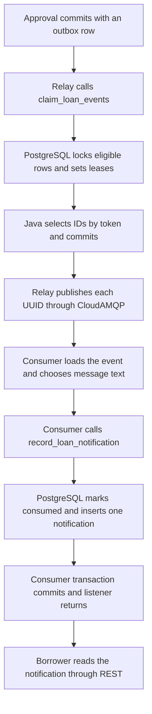

# Stored procedures in TrustBank

A stored procedure is a named routine that PostgreSQL stores and executes when an application issues `CALL`. In TrustBank’s notification pipeline, one procedure claims work for a publisher, and another records processing and inserts a borrower notification as one database operation. Spring Boot supplies the parameters through JDBC and owns the surrounding transactions. V7 extends the pipeline with [composite event detection](08-COMPOSITE-EVENT-DETECTION.md). [PostgreSQL CREATE PROCEDURE](https://www.postgresql.org/docs/18/sql-createprocedure.html) · [PostgreSQL CALL](https://www.postgresql.org/docs/18/sql-call.html)

## Files to open

| File | Responsibility |
| --- | --- |
| [`backend/src/main/resources/db/migration/V5__durable_loan_messaging.sql`](../../backend/src/main/resources/db/migration/V5__durable_loan_messaging.sql#L49) | Defines `claim_loan_messages(INT, UUID)` and `record_loan_notification(UUID, TEXT)` in PL/pgSQL, plus their supporting tables and indexes. |
| [`backend/src/main/resources/db/migration/V6__pin_messaging_routine_schema.sql`](../../backend/src/main/resources/db/migration/V6__pin_messaging_routine_schema.sql#L3) | Pins the routines’ PostgreSQL `search_path` to the value in effect when Flyway installs the migration. |
| [`V7__repeat_delinquency_events.sql`](../../backend/src/main/resources/db/migration/V7__repeat_delinquency_events.sql) | Extends the batch claim to both event types and keeps the V5 entry point for older workers. |
| [`backend/src/main/java/com/trustbank/loanapp/messaging/LoanMessageStore.java`](../../backend/src/main/java/com/trustbank/loanapp/messaging/LoanMessageStore.java#L22) | Executes the procedures through parameterized `JdbcTemplate` calls. |
| [`backend/src/main/java/com/trustbank/loanapp/messaging/LoanOutboxRelay.java`](../../backend/src/main/java/com/trustbank/loanapp/messaging/LoanOutboxRelay.java#L31) | Calls `claim(...)` before publishing and marks or retries each leased event. |
| [`backend/src/main/java/com/trustbank/loanapp/messaging/NotificationProcessor.java`](../../backend/src/main/java/com/trustbank/loanapp/messaging/NotificationProcessor.java#L15) | Starts the consumer transaction, loads the event and selects the notification text to pass to the write procedure. |
| [`backend/src/main/java/com/trustbank/loanapp/messaging/RabbitNotificationConsumer.java`](../../backend/src/main/java/com/trustbank/loanapp/messaging/RabbitNotificationConsumer.java#L17) | Calls the processor from the broker listener. |
| [`backend/src/main/java/com/trustbank/loanapp/event/NotificationSubscriber.java`](../../backend/src/main/java/com/trustbank/loanapp/event/NotificationSubscriber.java#L25) | Reuses the notification procedure in embedded mode before the loan transaction commits. |
| [`backend/src/main/resources/application.yml`](../../backend/src/main/resources/application.yml#L41), [`backend/pom.xml`](../../backend/pom.xml#L59) | Configure and include Flyway, which installs the SQL routines on deployment. |
| [`backend/src/test/java/com/trustbank/loanapp/messaging/LoanMessagingIntegrationTest.java`](../../backend/src/test/java/com/trustbank/loanapp/messaging/LoanMessagingIntegrationTest.java#L104) | Exercises both routines in actual PostgreSQL transactions. |

Flyway runs V5 to create the objects and V6 to stabilize table lookup. PostgreSQL resolves an unqualified name such as `notifications` using `search_path`. Saving the migration’s path directs the procedures to the intended schema’s tables, including when integration tests install the application in an isolated schema. V6 makes the change through a new migration so Flyway’s checksum for V5 remains valid.

## Procedure one claims a batch

`claim_loan_events` takes a batch size, a UUID lease token, and an optional event-type filter. The Java caller passes 10, generates a fresh token for each batch and passes SQL `NULL` to claim both event types. A **lease** is a time-limited claim that survives a transaction commit. It lets the worker release database locks while it waits on the broker.

```sql
CREATE PROCEDURE claim_loan_events(IN p_limit INT, IN p_token UUID, IN p_event_type TEXT)
LANGUAGE plpgsql SET search_path FROM CURRENT AS $$
BEGIN
    IF p_limit NOT BETWEEN 1 AND 10 OR p_token IS NULL THEN
        RAISE EXCEPTION 'Invalid message claim' USING ERRCODE = '22023';
    END IF;
    WITH selected AS (
        SELECT id FROM loan_message_outbox
        WHERE published_at IS NULL AND available_at <= now()
          AND (lease_until IS NULL OR lease_until < now())
          AND (p_event_type IS NULL OR event_type = p_event_type)
        ORDER BY created_at, id LIMIT p_limit FOR UPDATE SKIP LOCKED
    )
    UPDATE loan_message_outbox o SET lease_token = p_token,
        lease_until = now() + interval '120 seconds', attempts = attempts + 1
    FROM selected s WHERE o.id = s.id;
END;
$$;
```

1. The procedure checks the numeric batch size and requires a token. The query selects events with no `published_at`, whose `available_at` has arrived, and whose lease is absent or expired.
2. It orders the eligible events by creation time and ID. `FOR UPDATE SKIP LOCKED` locks available candidate rows and skips rows already locked by another transaction. Two workers can take separate batches without waiting on each other’s claimed rows. This is a work-queue query with no guarantee of global FIFO delivery under retries and concurrency. [PostgreSQL SELECT locking clauses](https://www.postgresql.org/docs/18/sql-select.html#SQL-FOR-UPDATE-SHARE)
3. The SQL assigns the token, sets a two-minute lease expiry and increments the attempt count. The claim becomes durable when Spring commits.

```java
@Transactional
public List<ClaimedMessage> claim(UUID token) {
    jdbc.update("CALL claim_loan_events(?, ?, NULL)", 10, token);
    return jdbc.query("SELECT id, event_type FROM loan_message_outbox "
            + "WHERE lease_token = ? AND published_at IS NULL ORDER BY created_at, id",
            (rs, row) -> new ClaimedMessage(rs.getObject("id", UUID.class),
                    LoanMessageType.valueOf(rs.getString("event_type"))), token);
}
```

The procedure updates the table and declares no output parameters. Java selects the IDs with its token inside the same transaction. The relay receives that list after commit and contacts CloudAMQP. A successful confirm lets `complete(...)` mark the event published. The update checks the token again to stop a stale worker from finishing another worker’s claim. A publish failure calls `retryLater(...)`, and a worker crash leaves an expiring lease. [Relay completion and retry](../../backend/src/main/java/com/trustbank/loanapp/messaging/LoanMessageStore.java#L50)

## Procedure two records a notification once

`record_loan_notification` takes the event UUID and the message text. The consumer first loads the stored event. The Java method `NotificationText.messageFor(...)` chooses the wording, and PostgreSQL uses the persisted event payload to find the borrower and loan. This puts notification wording in the application and the atomic write in the database.

```sql
CREATE PROCEDURE record_loan_notification(IN p_event_id UUID, IN p_message TEXT)
LANGUAGE plpgsql AS $$
DECLARE event_payload JSONB;
BEGIN
    UPDATE loan_message_outbox SET consumed_at = now()
        WHERE id = p_event_id AND consumed_at IS NULL RETURNING payload INTO event_payload;
    IF NOT FOUND THEN RETURN; END IF;
    IF p_message IS NOT NULL THEN
        INSERT INTO notifications(user_id, loan_application_id, message, source_event_id)
        VALUES ((event_payload->>'applicantId')::uuid,
                (event_payload->>'applicationId')::uuid, p_message, p_event_id);
    END IF;
END;
$$;
```

The guarded `UPDATE` can claim processing only while `consumed_at` is null. `RETURNING payload INTO event_payload` fetches the JSONB payload from the row that changed. `FOUND` reflects whether the update affected a row. A missing or already consumed event returns promptly. Concurrent deliveries compete on the same row, and only the successful first consumer can proceed with the notification insert. The source event’s unique index also prevents duplicate notification rows.

The expression `event_payload->>'applicantId'` extracts text from JSONB and the `::uuid` cast converts it to a database UUID. A null `p_message` means the application intentionally produces no notification for that status. The event is still marked consumed. If the insert fails, the surrounding transaction rolls back the consume marker so the event remains eligible for recovery.

```java
public void recordNotification(UUID id, String message) {
    jdbc.update("CALL record_loan_notification(?, ?)", id, message);
}
```

Both methods use `?` parameters. `JdbcTemplate` binds their values separately from the SQL text. The procedure neither opens a new connection nor commits independently. The caller’s transaction determines when the work becomes permanent.

## End-to-end flow for an approval



The first routine protects the handoff from the database to a publisher. The second protects the final write when a message arrives more than once. Network calls and the broker acknowledgment happen in Java around these database transactions.

## Presentation walkthrough

1. In V5, point out `CREATE PROCEDURE`, `LANGUAGE plpgsql` and each `IN` parameter. Then open `LoanMessageStore` and show where `CALL` executes the routine.
2. Walk through a worker crash after a claim. The short transaction already committed, so the locks are gone and the token remains until the lease expires. Another worker can then acquire the work.
3. Walk through a duplicate message with the same UUID. Once `consumed_at` has been committed, the update affects zero rows and the procedure returns before creating a second notification.
4. Show the integration tests that lock a row, recover an expired lease and force a notification insert to fail. [Lease test](../../backend/src/test/java/com/trustbank/loanapp/messaging/LoanMessagingIntegrationTest.java#L124) · [Notification rollback test](../../backend/src/test/java/com/trustbank/loanapp/messaging/LoanMessagingIntegrationTest.java#L114)

**Likely question. What is the difference between a procedure and a trigger here?** Java explicitly executes these two procedures with `CALL`. PostgreSQL automatically fires the triggers when a row is inserted into `loan_status_history`. Those triggers invoke functions declared with `RETURNS trigger`.

**Likely question. Why are these two operations in SQL?** They work on shared rows and need database-level concurrency control. The routines give each operation a single entry point while preserving Spring’s control of commit and rollback.

[Transactions and ACID](01-TRANSACTIONS-ACID.md) · [Message Oriented Middleware](02-MESSAGE-ORIENTED-MIDDLEWARE.md) · [Triggers](04-TRIGGERS.md)
