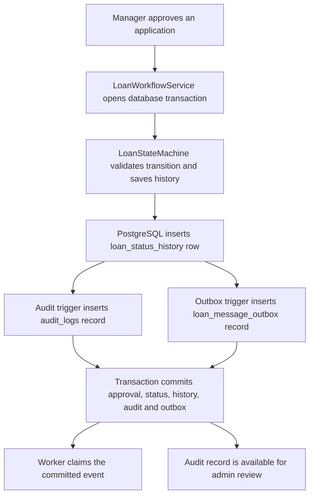

# Database triggers in TrustBank

A trigger tells PostgreSQL to run a function automatically when a specified table event occurs. TrustBank attaches two row triggers to inserts into `loan_status_history`. They record a status audit and enqueue an event in the same transaction as the status change. The application’s state machine supplies the history row with the original status, the new status, the actor, an optional note and the timestamp. [PostgreSQL CREATE TRIGGER](https://www.postgresql.org/docs/18/sql-createtrigger.html)

## Files to open

| File | Responsibility |
| --- | --- |
| [`backend/src/main/resources/db/migration/V1__init_schema.sql`](../../backend/src/main/resources/db/migration/V1__init_schema.sql#L115) | Creates `loan_status_history` and its foreign keys. The same migration defines `audit_logs` at line 219. |
| [`backend/src/main/resources/db/migration/V5__durable_loan_messaging.sql`](../../backend/src/main/resources/db/migration/V5__durable_loan_messaging.sql#L21) | Defines both PL/pgSQL trigger functions and their `AFTER INSERT` registrations. |
| [`backend/src/main/resources/db/migration/V6__pin_messaging_routine_schema.sql`](../../backend/src/main/resources/db/migration/V6__pin_messaging_routine_schema.sql#L3) | Saves the migration’s `search_path` for the trigger functions and procedures. |
| [`backend/src/main/java/com/trustbank/loanapp/service/LoanStateMachine.java`](../../backend/src/main/java/com/trustbank/loanapp/service/LoanStateMachine.java#L43) | Sets the business status and saves the history row that activates the triggers. |
| [`backend/src/main/java/com/trustbank/loanapp/service/LoanApplicationService.java`](../../backend/src/main/java/com/trustbank/loanapp/service/LoanApplicationService.java#L124), [`backend/src/main/java/com/trustbank/loanapp/service/LoanWorkflowService.java`](../../backend/src/main/java/com/trustbank/loanapp/service/LoanWorkflowService.java#L234) | Examples of transactional callers from borrower submission and manager decisions. |
| [`backend/src/main/java/com/trustbank/loanapp/event/AuditSubscriber.java`](../../backend/src/main/java/com/trustbank/loanapp/event/AuditSubscriber.java#L21) | Handles other Java audit events. Status-change audit rows come from the database trigger. |
| [`backend/src/main/java/com/trustbank/loanapp/web/AdminController.java`](../../backend/src/main/java/com/trustbank/loanapp/web/AdminController.java#L86) | Lets administrators view recent audit records at `GET /api/v1/audit-logs`. |
| [`backend/src/main/java/com/trustbank/loanapp/event/NotificationSubscriber.java`](../../backend/src/main/java/com/trustbank/loanapp/event/NotificationSubscriber.java#L25), [`backend/src/main/java/com/trustbank/loanapp/messaging/LoanOutboxRelay.java`](../../backend/src/main/java/com/trustbank/loanapp/messaging/LoanOutboxRelay.java#L26) | Use the outbox in embedded mode and broker mode, respectively. |
| [`backend/src/test/java/com/trustbank/loanapp/messaging/LoanMessagingIntegrationTest.java`](../../backend/src/test/java/com/trustbank/loanapp/messaging/LoanMessagingIntegrationTest.java#L83) | Proves that a history insert creates one audit row and one event, and all three roll back together. |

## The Java statement that starts the chain

The state machine checks whether the old status can move to the target. It updates the application and fills in the new history entity. These are the values used by both triggers.

```java
public void move(LoanApplication application, LoanStatus target, UUID actorId, String note) {
    LoanStatus from = application.getStatus();
    if (from != null && !from.canMoveTo(target)) {
        throw ApiException.rule("ILLEGAL_TRANSITION",
                "A loan that is " + from + " cannot become " + target);
    }
    Instant now = clock.instant();
    application.setStatus(target);
    application.setUpdatedAt(now);

    LoanStatusHistory row = new LoanStatusHistory();
    row.setLoanApplicationId(application.getId());
    row.setFromStatus(from);
    row.setToStatus(target);
    row.setChangedBy(actorId);
    row.setNote(note);
    row.setChangedAt(now);
    history.save(row);
```

Hibernate executes the SQL `INSERT` when it flushes the history entity. PostgreSQL then fires the row triggers against the newly inserted row. The Java Spring event published by the next lines is separate. It supports consumers such as the credit-check worker and the embedded notification listener. The durable outbox is created by the history insert itself. [Spring event publication](../../backend/src/main/java/com/trustbank/loanapp/service/LoanStateMachine.java#L62)

## Trigger one adds the event to the outbox

```sql
CREATE FUNCTION enqueue_loan_status_message() RETURNS trigger LANGUAGE plpgsql AS $$
BEGIN
    INSERT INTO loan_message_outbox(id, loan_application_id, payload)
    SELECT NEW.id, NEW.loan_application_id, jsonb_build_object(
        'applicationId', a.id, 'reference', a.reference, 'applicantId', a.applicant_id,
        'from', NEW.from_status, 'to', NEW.to_status, 'actorId', NEW.changed_by,
        'note', NEW.note, 'occurredAt', NEW.changed_at)
    FROM loan_applications a WHERE a.id = NEW.loan_application_id;
    RETURN NEW;
END;
$$;
CREATE TRIGGER loan_status_message_trigger AFTER INSERT ON loan_status_history
    FOR EACH ROW EXECUTE FUNCTION enqueue_loan_status_message();
```

- `CREATE FUNCTION ... RETURNS trigger` defines the trigger function. `CREATE TRIGGER` attaches the function to a table event.
- `AFTER INSERT ON loan_status_history` runs after the history insert executes, while its enclosing transaction is still open.
- `FOR EACH ROW` runs the function once for every inserted history row. `NEW` is that row in PL/pgSQL. An insert has a new row and no previous row in the trigger context. `NEW.from_status` is a column Java populated with the workflow’s prior status.
- The `SELECT` takes the trusted application reference and applicant ID from `loan_applications`. `jsonb_build_object` combines these with the status transition metadata.
- The event’s `id` equals the history row’s UUID. Using the same identity lets the relay, broker and notification procedure refer to one event across process boundaries. The outbox primary key and foreign key enforce that relationship.

For an approval, the outbox payload has `from = UNDER_REVIEW` and `to = APPROVED`. It also includes the application ID, borrower ID, public reference, actor, note and time. The worker later publishes the UUID and reads the payload from PostgreSQL. The trigger does no network I/O.

## Trigger two adds the audit row

```sql
CREATE FUNCTION audit_loan_status_change() RETURNS trigger LANGUAGE plpgsql AS $$
BEGIN
    INSERT INTO audit_logs(entity_type, entity_id, action, performed_by, performed_at, details)
    SELECT 'LOAN_APPLICATION', NEW.loan_application_id, 'STATUS_' || NEW.to_status,
        NEW.changed_by, NEW.changed_at, jsonb_build_object(
            'reference', a.reference, 'from', NEW.from_status, 'to', NEW.to_status, 'note', NEW.note)
    FROM loan_applications a WHERE a.id = NEW.loan_application_id;
    RETURN NEW;
END;
$$;
CREATE TRIGGER loan_status_audit_trigger AFTER INSERT ON loan_status_history
    FOR EACH ROW EXECUTE FUNCTION audit_loan_status_change();
```

The audit function saves the loan ID as `entity_id`, the manager as `performed_by`, and the transition time as `performed_at`. The action uses `'STATUS_' || NEW.to_status`, so an approval creates an audit action called `STATUS_APPROVED`. The JSON details include the loan reference, previous and new status, and any note. Both trigger functions return `NEW`. With an `AFTER` row trigger, PostgreSQL ignores the return value for the already-inserted row. [PostgreSQL trigger function behavior](https://www.postgresql.org/docs/18/plpgsql-trigger.html)

The two functions use the same history row independently. The audit records what happened for review. The outbox records work that the notification pipeline needs to perform. Both are durable when the enclosing database transaction commits.

## End-to-end flow for an approval



On rollback, the status change, history, audit and outbox writes are removed together. A procedure or a broker call plays no part in firing these triggers. A direct `UPDATE loan_applications SET status = ...` alone never inserts status history, so it does not fire them. The application’s normal API routes create the history row and enforce allowed transitions first.

One API action can insert more than one history row. Disbursement records `DISBURSED` and then `ACTIVE` in a single transaction. Each history row gets its own audit and outbox row. V5 adds triggers for future history inserts and does not replay earlier history. [Disbursement transitions](../../backend/src/main/java/com/trustbank/loanapp/service/DisbursementService.java#L88)

## Presentation walkthrough

1. Open `LoanStateMachine.move(...)` and point to `history.save(row)`.
2. In V5, point to the event table and the words `AFTER INSERT` and `FOR EACH ROW`. Explain how `NEW.to_status` becomes the audit action and an outbox payload field.
3. For a sample approved loan, use its UUID to compare the history row ID with the outbox ID and check for `STATUS_APPROVED` in the audit trail. The integration tests are a reproducible option for showing a committed insert and a rolled-back insert. [Trigger and rollback tests](../../backend/src/test/java/com/trustbank/loanapp/messaging/LoanMessagingIntegrationTest.java#L83)

**Likely question. Does AFTER INSERT mean after commit?** It means after the row insert runs. The two writes are still inside the original transaction and are undone together on rollback.

**Likely question. Why attach the triggers to history?** A history row has the actor, note, previous status, new status and time. Those fields let both functions build accurate records even if one service changes the application’s status twice before commit.

[Transactions and ACID](01-TRANSACTIONS-ACID.md) · [Message Oriented Middleware](02-MESSAGE-ORIENTED-MIDDLEWARE.md) · [Stored procedures](03-STORED-PROCEDURES.md)
