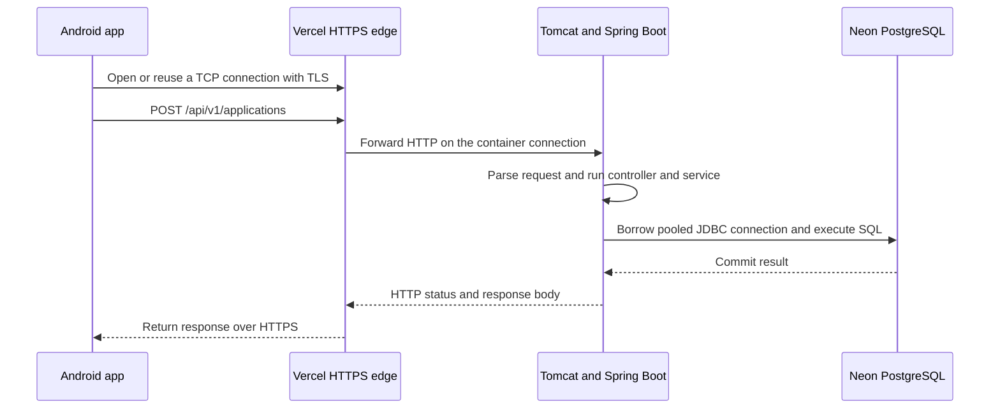

# Sockets TCP and UDP in TrustBank

**TrustBank uses TCP sockets through Tomcat, OkHttp and the database and broker drivers.** Tomcat opens a listening socket on the server. The clients and drivers open outbound sockets to send HTTP requests, database commands and AMQP messages. The application configures these libraries. The low-level calls to bind, connect, accept and close are inside those libraries.

The project source contains no direct `ServerSocket`, `SocketChannel` or `DatagramSocket` implementation and no application WebSocket endpoint. If asked to show `bind()` in the presentation, open the Tomcat source linked below and show the Spring configuration that supplies its arguments. The Java demo shows how to call the same socket operations directly.

## TCP and UDP

A socket is a communication endpoint. A TCP connection has a local IP address and port and a remote IP address and port. A client such as `192.0.2.15:53142` can connect to a server at `192.0.2.20:443`. The OS normally chooses the client’s temporary source port. Many clients can share the destination port because their connections have different endpoint pairs. [TCP specification](https://www.rfc-editor.org/rfc/rfc9293.html)

| Property | TCP | UDP |
| --- | --- | --- |
| Setup | Establishes a connection with a SYN, SYN-ACK and ACK handshake. | Sends datagrams without a transport handshake. |
| Data | Reliable, ordered **byte stream**. One write can arrive in several reads. The application protocol supplies message boundaries. | Each datagram has a message boundary. UDP gives no inherent guarantee of delivery, ordering or duplicate protection. |
| Server | Binds, listens and accepts a separate connected socket for each connection. | Binds and receives datagrams on the same socket. |
| TrustBank | HTTP/1.1, HTTP/2, PostgreSQL, MongoDB and AMQP sessions use TCP. | No UDP data service is implemented by the application. A browser can use HTTP/3 over QUIC and UDP on a hop to a compatible edge. |

HTTP, PostgreSQL, MongoDB and AMQP define the messages. TCP or UDP carries them. TLS secures supported sessions. DNS can use UDP or TCP for host discovery, which is a separate exchange from the request or database connection that follows. [UDP specification](https://www.rfc-editor.org/rfc/rfc768.html) · [HTTP/3 specification](https://www.rfc-editor.org/rfc/rfc9114.html)

## Connections in the project

| Client and server | Protocol | Destination and configuration |
| --- | --- | --- |
| Android → Vercel API | Retrofit builds HTTP requests. OkHttp 4.12 defaults to HTTP/2 and HTTP/1.1, both over TCP with TLS for HTTPS. | HTTPS uses port 443 by default. `API_BASE_URL` supplies the backend origin. The emulator fallback is `http://10.0.2.2:8080/`. |
| React → Vercel API | The browser manages `fetch(...)` sockets. HTTP/1.1 and HTTP/2 use TCP. HTTP/3 uses QUIC over UDP when negotiated. | `VITE_API_URL` supplies the backend origin. |
| Vercel proxy or local client → Tomcat | HTTP on a TCP listener. In the hosted setup, the public TLS connection terminates at the proxy. | Tomcat uses the runtime `PORT` or falls back to 8080. Forwarded headers convey the original scheme. The daemon has its own internal HTTP liveness listener on 8080. |
| API and worker → Neon PostgreSQL | pgJDBC carries the PostgreSQL wire protocol over TCP. The Neon configuration requests TLS. | `DATABASE_URL` supplies host, optional port, database and options. The default port is 5432. HikariCP pools physical connections. |
| API → MongoDB Atlas | MongoDB wire protocol over TCP. The `mongodb+srv://` URL enables TLS by default and discovers hosts and ports with DNS. | `MONGODB_URI` supplies the seed host, credentials and options. Atlas normally uses 27017. GridFS file data is carried by MongoDB. |
| Worker → CloudAMQP LavinMQ | Spring AMQP uses AMQP 0-9-1 over TCP and TLS to the hosted broker. | `RABBITMQ_ADDRESSES` supplies host, credentials and virtual host. AMQPS uses 5671 on the hosted broker. Local AMQP uses 5672. |

[OkHttp defaults](https://github.com/square/okhttp/blob/parent-4.12.0/okhttp/src/main/kotlin/okhttp3/OkHttpClient.kt#L994) · [Vercel headers](https://vercel.com/docs/headers/request-headers#x-forwarded-proto) · [pgJDBC connection options](https://jdbc.postgresql.org/documentation/use/) · [MongoDB connection strings](https://www.mongodb.com/docs/manual/reference/connection-string-formats/#srv-connection-format) · [LavinMQ protocols and ports](https://lavinmq.com/documentation/amqp-the-protocol)

## Files to open

| File | Responsibility |
| --- | --- |
| [`backend/src/main/java/com/trustbank/loanapp/LoanBackendApplication.java`](../../backend/src/main/java/com/trustbank/loanapp/LoanBackendApplication.java#L13), [`backend/pom.xml`](../../backend/pom.xml#L26) | Start Spring Boot and bring in embedded Tomcat through the web starter. |
| [`backend/src/main/resources/application.yml`](../../backend/src/main/resources/application.yml#L87), [`backend/Dockerfile`](../../backend/Dockerfile#L15) | Configure the listener port, backlog, connection limits, timeouts and shutdown. Docker declares port 8080. |
| [`mobile/app/src/main/java/com/trustbank/loanapp/data/remote/ApiClient.kt`](../../mobile/app/src/main/java/com/trustbank/loanapp/data/remote/ApiClient.kt#L55), [`mobile/app/src/main/java/com/trustbank/loanapp/data/remote/LoanApi.kt`](../../mobile/app/src/main/java/com/trustbank/loanapp/data/remote/LoanApi.kt#L60), [`mobile/app/build.gradle.kts`](../../mobile/app/build.gradle.kts#L49) | Configure OkHttp and Retrofit, declare the loan application request and select the base URL. |
| [`web/src/api/client.ts`](../../web/src/api/client.ts#L76) | Call browser `fetch(url, options)` with a method, headers, body and abort signal. The general request helper uses a 15-second timeout per attempt. |
| [`backend/src/main/resources/application.yml`](../../backend/src/main/resources/application.yml#L8), [`backend/.env.example`](../../backend/.env.example#L5) | Configure HikariCP and show the PostgreSQL connection URL shape. |
| [`backend/src/main/java/com/trustbank/loanapp/storage/GridFsDocumentStorage.java`](../../backend/src/main/java/com/trustbank/loanapp/storage/GridFsDocumentStorage.java#L35), [`backend/src/main/java/com/trustbank/loanapp/storage/GridFsDocumentStorage.java`](../../backend/src/main/java/com/trustbank/loanapp/storage/GridFsDocumentStorage.java#L119) | Set MongoDB socket and pool parameters. Close the shared driver client at Spring teardown. |
| [`backend/src/main/resources/application.yml`](../../backend/src/main/resources/application.yml#L52), [`backend/src/main/java/com/trustbank/loanapp/messaging/RabbitLoanPublisher.java`](../../backend/src/main/java/com/trustbank/loanapp/messaging/RabbitLoanPublisher.java#L22), [`backend/src/main/java/com/trustbank/loanapp/messaging/RabbitNotificationConsumer.java`](../../backend/src/main/java/com/trustbank/loanapp/messaging/RabbitNotificationConsumer.java#L17), [`backend/vercel.json`](../../backend/vercel.json#L4) | Configure AMQP connectivity, publish and consume messages, and start the Vercel worker. |
| [`backend/src/main/java/com/trustbank/loanapp/web/ApplicationController.java`](../../backend/src/main/java/com/trustbank/loanapp/web/ApplicationController.java#L57) | Handle a parsed borrower submission after Tomcat has accepted the connection and read the request. |

## Methods and parameters

The table maps the C/POSIX socket lifecycle to Java. Tomcat uses the Java NIO channel variants. [Java ServerSocket](https://docs.oracle.com/en/java/javase/21/docs/api/java.base/java/net/ServerSocket.html) · [Java ServerSocketChannel](https://docs.oracle.com/en/java/javase/21/docs/api/java.base/java/nio/channels/ServerSocketChannel.html) · [Java Socket](https://docs.oracle.com/en/java/javase/21/docs/api/java.base/java/net/Socket.html)

| Operation | Parameters and effect | TrustBank equivalent |
| --- | --- | --- |
| `socket(domain, type, protocol)` | Domain selects IPv4 `AF_INET` or IPv6 `AF_INET6`. Type selects `SOCK_STREAM` or `SOCK_DGRAM`. Protocol is typically TCP, UDP, or `0` to choose the default for that type. Returns a socket descriptor. | Tomcat calls `ServerSocketChannel.open()`. OkHttp and the drivers open client sockets internally. |
| `bind(fd, address, addressLength)` | Associates a socket with a **local IP and port**. Java passes them as `InetSocketAddress(hostOrAddress, port)` and hides the address length. A wildcard address binds available interfaces, and port `0` asks the OS to pick a port. | Tomcat uses `ServerSocketChannel.bind(SocketAddress local, int backlog)`. Outbound clients can bind a local endpoint explicitly, but the OS normally assigns it. |
| `listen(fd, backlog)` | Makes a bound TCP socket a listener. The backlog requests a limit on pending connections, subject to the OS. Java’s server `bind(local, backlog)` sets up the listener without a separate `listen()` call. | Tomcat requests a backlog of `100` through `accept-count`. |
| `connect(fd, remote, addressLength)` | Connects the client to the **remote IP and port**. Java’s `Socket.connect(SocketAddress endpoint, int timeout)` also takes a connect timeout in milliseconds. A timeout of `0` means no Java connect deadline. | OkHttp connects to a fresh destination route or reuses a compatible pooled connection. The configured Android connect timeout is 10 seconds. |
| `accept(fd, peerAddress, peerAddressLength)` | Returns a separate connected socket. The address outputs can identify the peer. Java `accept()` takes no arguments. | Tomcat’s `serverSock.accept()` returns a `SocketChannel`. The listening socket stays open. |
| `send(fd, buffer, length, flags)` and `recv(fd, buffer, length, flags)` | Buffer and length specify the bytes to send or the most to receive. Flags modify behavior. Java socket streams use `write(byte[], offset, length)` and `read(byte[], offset, length)`. Read returns a byte count or `-1` at end of stream. NIO reads and writes use `ByteBuffer`. | HTTP, database and AMQP clients frame their protocol messages over these byte streams. |
| `shutdown(fd, how)` | Ends one or both directions. Java `shutdownOutput()` stops local sending while still permitting reads. `shutdownInput()` ends local reading. | Libraries manage transport shutdown. Finishing one HTTP request may leave the connection open for reuse. |
| `close(fd)` | Releases the socket. Java `close()` has no arguments. Closing a connected socket ends that connection. Closing the listener stops new accepts on it. | Tomcat and the drivers close physical connections during shutdown, eviction, or after a connection becomes unusable. |

For UDP, `new DatagramSocket(null)` creates an unbound socket. `bind(SocketAddress local)` assigns the local IP and port. `send(DatagramPacket p)` supplies the data buffer, offset, length and destination. `receive(DatagramPacket p)` fills a buffer and reports the sender and received length. `setSoTimeout(int millis)` bounds a receive. An optional `connect(remote)` sets a default peer and limits packets to that peer without a transport handshake. UDP has no `listen()` or `accept()` step. `close()` releases the datagram socket. [Java DatagramSocket](https://docs.oracle.com/en/java/javase/21/docs/api/java.base/java/net/DatagramSocket.html) · [Java DatagramPacket](https://docs.oracle.com/en/java/javase/21/docs/api/java.base/java/net/DatagramPacket.html)

## Key code in the application and libraries

The backend configures Tomcat’s listener.

```yaml
server:
  port: ${PORT:8080}
  forward-headers-strategy: framework   # TLS terminates at the host/proxy; trust X-Forwarded-*
  shutdown: graceful
  error:
    include-message: never
    include-stacktrace: never
  tomcat:
    # --- Thread pool model (CS423): workers are pre-created and reused, never
    # one fork()/thread per request. ----------------------------------------
    threads:
      max: ${HTTP_THREADS_MAX:50}
      min-spare: ${HTTP_THREADS_MIN:10}
    accept-count: 100              # listen backlog once every worker is busy
    max-connections: 2000
    connection-timeout: 10s        # a slow/dead client cannot pin a worker forever
    keep-alive-timeout: 15s
```

In **Tomcat 10.1.48**, `NioEndpoint.initServerSocket()` opens a server channel, builds `InetSocketAddress(getAddress(), getPortWithOffset())`, then calls `serverSock.bind(addr, getAcceptCount())`. `serverSocketAccept()` calls `serverSock.accept()`. The endpoint registers accepted connections with a poller and dispatches work to its executor. `doCloseServerSocket()` calls `serverSock.close()` during teardown. [Tomcat bind](https://github.com/apache/tomcat/blob/10.1.48/java/org/apache/tomcat/util/net/NioEndpoint.java#L214) · [Tomcat accept](https://github.com/apache/tomcat/blob/10.1.48/java/org/apache/tomcat/util/net/NioEndpoint.java#L504) · [Tomcat close](https://github.com/apache/tomcat/blob/10.1.48/java/org/apache/tomcat/util/net/NioEndpoint.java#L364)

`accept-count`, `max-connections` and `threads.max` control three different resources. They are the requested OS backlog, the Tomcat connection limit and the request executor’s thread limit. `connection-timeout=10s` governs the wait for the HTTP request line after accepting. `keep-alive-timeout=15s` governs how long Tomcat waits for another request on a persistent connection. Docker’s `EXPOSE 8080` describes a port. The Java process binds it at runtime. [Tomcat connector settings](https://tomcat.apache.org/tomcat-10.1-doc/config/http.html)

Android sets a connect deadline, individual read and write timeouts and a total call deadline. Retrofit uses this same OkHttp client for its requests.

```kotlin
private val httpClient: OkHttpClient by lazy {
    OkHttpClient.Builder()
        .addInterceptor(authInterceptor)
        // Bounded waits on the client side too: a dead connection fails instead of hanging the screen.
        .connectTimeout(10, TimeUnit.SECONDS)
        // Hosted Spring Boot cold starts observed at 22-26s; allow them without unbounded waits.
        .readTimeout(60, TimeUnit.SECONDS)
        .writeTimeout(60, TimeUnit.SECONDS)
        .callTimeout(90, TimeUnit.SECONDS)
        .build()
}

val api: LoanApi by lazy {
    val baseUrl = BuildConfig.API_BASE_URL.let { if (it.endsWith("/")) it else "$it/" }
    Retrofit.Builder()
        .baseUrl(baseUrl)
        .client(httpClient)
        .addConverterFactory(GsonConverterFactory.create(gson))
        .build()
        .create(LoanApi::class.java)
```

The MongoDB driver has a 10-second server selection timeout, a 10-second socket connect timeout and a 20-second socket read timeout. `maxSize(10)` caps pooled connections per server and `maxWaitTime(3, SECONDS)` limits waiting for one. Spring calls the shared client’s `close()` at bean teardown.

```java
MongoClientSettings settings = MongoClientSettings.builder()
        .applyConnectionString(new ConnectionString(uri))
        .applyToClusterSettings(s -> s.serverSelectionTimeout(10, TimeUnit.SECONDS))
        .applyToSocketSettings(s -> s.connectTimeout(10, TimeUnit.SECONDS).readTimeout(20, TimeUnit.SECONDS))
        .applyToConnectionPoolSettings(s -> s.maxSize(10).maxWaitTime(3, TimeUnit.SECONDS))
        .build();
client = MongoClients.create(settings);
bucket = GridFSBuckets.create(client.getDatabase(database), bucketName);
```

```java
@PreDestroy
public void close() { if (client != null) client.close(); }
```

## End-to-end loan submission



1. For a fresh route, the Android client resolves the API hostname, TCP performs its handshake, then TLS negotiates encryption before HTTP request bytes are sent. In local mode, the client connects directly to Tomcat. In production, the Vercel edge forwards the request to the container’s Tomcat listener.
2. Tomcat reads the bytes, interprets the HTTP request, and hands it to Spring. The service borrows a JDBC connection. The application’s `connection-timeout: 3000` under `hikari` is a three-second **pool acquisition timeout**. Closing a borrowed connection normally returns it to the pool. Hikari closes the physical TCP connection when it retires it. [HikariCP configuration](https://github.com/brettwooldridge/HikariCP#frequently-used)
3. Tomcat writes the HTTP response. The HTTP connection can be reused, or the corresponding network components can close it. A lost response can occur after a database commit. The API’s idempotency key allows safe retries of a submission. [Transactions and ACID](01-TRANSACTIONS-ACID.md)
4. The notification worker separately uses an AMQPS connection to the broker. The AMQP heartbeat helps peers detect failures. HTTP keep-alive, Hikari’s validation of idle database connections, AMQP heartbeats and TCP `SO_KEEPALIVE` are separate mechanisms. A TCP ACK confirms receipt at the transport layer. The broker confirm, consumer acknowledgment and database commit describe different stages of application work. [Message Oriented Middleware](02-MESSAGE-ORIENTED-MIDDLEWARE.md)

## Run a direct Java TCP example

Save this teaching example as `SocketDemo.java` in a temporary folder and run `java SocketDemo.java` with Java 21. It uses only local loopback traffic. Port `0` asks the OS for a free port, `8` is the requested backlog, and the timeout arguments are milliseconds. The newline delimits messages in the TCP byte stream.

```java
import java.io.BufferedReader;
import java.io.IOException;
import java.io.InputStreamReader;
import java.net.InetAddress;
import java.net.InetSocketAddress;
import java.net.ServerSocket;
import java.net.Socket;
import java.nio.charset.StandardCharsets;
import java.util.concurrent.Executors;
import java.util.concurrent.TimeUnit;

public class SocketDemo {
    public static void main(String[] args) throws Exception {
        InetAddress loopback = InetAddress.getByName("127.0.0.1");
        try (var listener = new ServerSocket();
             var executor = Executors.newSingleThreadExecutor()) {
            listener.bind(new InetSocketAddress(loopback, 0), 8);
            listener.setSoTimeout(3000);
            int port = listener.getLocalPort();

            var served = executor.submit(() -> {
                try (Socket peer = listener.accept()) {
                    peer.setSoTimeout(3000);
                    if (!"PING".equals(readLine(peer))) {
                        throw new IOException("Expected PING");
                    }
                    peer.getOutputStream().write(
                            "PONG\n".getBytes(StandardCharsets.US_ASCII));
                } // peer.close()
                return null;
            });

            try (var client = new Socket()) {
                client.connect(new InetSocketAddress(loopback, port), 2000);
                client.setSoTimeout(3000);
                client.getOutputStream().write(
                        "PING\n".getBytes(StandardCharsets.US_ASCII));
                if (!"PONG".equals(readLine(client))) {
                    throw new IOException("Expected PONG");
                }
                System.out.println("PONG received on TCP port " + port);
            } // client.close()
            served.get(5, TimeUnit.SECONDS);
        } // executor and listener.close()
    }

    static String readLine(Socket socket) throws IOException {
        return new BufferedReader(new InputStreamReader(
                socket.getInputStream(), StandardCharsets.US_ASCII)).readLine();
    }
}
```

`listener.setSoTimeout(...)` bounds the blocking `accept()`. `peer.setSoTimeout(...)` and `client.setSoTimeout(...)` bound blocking socket reads. Try-with-resources calls `close()` even when an exception occurs.

## Presentation questions

**Which call takes the port?** `bind(...)` receives the local listening port. `connect(...)` receives the remote destination port. A client usually lets the OS pick its own local source port.

**How do we find the actual bind and close calls?** Open the Tomcat version linked above. Show how the project supplies connector values in `application.yml`, then point to `NioEndpoint`. Use the Java example if asked to demonstrate the methods directly.

**Does TCP mean a loan or notification succeeded?** TCP reliably transports an ordered stream of bytes. PostgreSQL commit confirms database changes, and AMQP confirms and acknowledgments track messaging outcomes. A closed connection by itself establishes neither result.

**Why does accept return a second socket?** The listening socket stays available for new clients. The new socket is tied to one peer and carries that connection’s traffic.

[Stored procedures](03-STORED-PROCEDURES.md) · [Database triggers](04-TRIGGERS.md)
