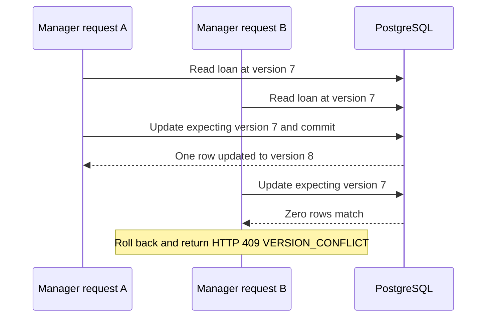

# Concurrency in the TrustBank backend and database

**TrustBank is a concurrent client-server system. The HTTP server uses a thread pool.** Embedded Tomcat can handle requests from multiple clients at overlapping times. Spring uses a separate, bounded thread pool for selected background work. PostgreSQL handles concurrent database sessions and uses transactions, locking and constraints to keep shared records consistent.

An iterative server finishes one request before it starts the next. A concurrent server can make progress on several requests during the same period. That can mean alternating work while some requests wait for I/O, or running work in parallel when CPU cores are available. A single controller method can run synchronously from start to finish on its assigned thread while other requests run on other threads.

## Which model does each component use

| Component | Model | Settings in this project |
| --- | --- | --- |
| Embedded Tomcat HTTP server | Reusable **request thread pool**. A synchronous request occupies a worker while it runs. | Defaults to 50 maximum request threads and 10 minimum running threads through `HTTP_THREADS_MAX` and `HTTP_THREADS_MIN`. There is also a 2,000 connection limit and requested OS backlog of 100. |
| Credit-check and non-status audit listeners | Separate, bounded **Spring async thread pool**. | Core size 4, maximum 8, queue capacity 200. Threads use the `loan-bg-` prefix. |
| Scheduled tasks | **Spring task scheduler**. This is separate from the named async executor. | Default scheduler has one thread with the committed configuration. The relay uses a five-second fixed delay after the previous run ends. |
| AMQP notification processing | **Broker listener container**. It runs on the daemon independently of HTTP requests. | Default is one consumer per enabled listener container. `prefetch: 10` allows up to ten unacknowledged deliveries per consumer. The deployment defines one daemon instance. |
| HikariCP | **Database connection pool** for reuse of open PostgreSQL sessions. | API defaults to 10 maximum and 4 minimum idle connections per running instance. The daemon overrides these to 4 maximum and 0 minimum idle. |
| PostgreSQL on Neon | **Concurrent transactions** over multiple database sessions. | The application relies on the database’s default isolation, ordinarily Read Committed, and uses specific coordination mechanisms for each workflow. |

In a **thread-on-demand** model, the server creates a worker for each new request or connection and retires it when that work ends. Our Tomcat pool can still create more workers when demand rises, up to its configured limit. Those workers remain available to handle future requests. Java 21 is the runtime and the application configures no opt-in to virtual threads. The configured limits apply per instance, so 50 HTTP threads is neither the global Vercel limit nor a measured request throughput. [Tomcat HTTP connector](https://tomcat.apache.org/tomcat-10.1-doc/config/http.html) · [Spring Boot scheduling](https://docs.spring.io/spring-boot/3.5/reference/features/task-execution-and-scheduling.html) · [Spring AMQP concurrency](https://docs.spring.io/spring-amqp/reference/3.2/amqp/listener-concurrency.html)

## Files to open

| File | What to show |
| --- | --- |
| [`backend/src/main/resources/application.yml`](../../backend/src/main/resources/application.yml#L94), [`backend/src/main/resources/application.yml`](../../backend/src/main/resources/application.yml#L13), [`backend/src/main/resources/application.yml`](../../backend/src/main/resources/application.yml#L162) | Tomcat request threads, JDBC connection-pool limits, database timeouts and background executor sizes. |
| [`backend/src/main/java/com/trustbank/loanapp/config/AsyncConfig.java`](../../backend/src/main/java/com/trustbank/loanapp/config/AsyncConfig.java#L27), [`backend/src/main/java/com/trustbank/loanapp/config/AppProperties.java`](../../backend/src/main/java/com/trustbank/loanapp/config/AppProperties.java) | Registers the named executor and reads typed configuration. |
| [`backend/src/main/java/com/trustbank/loanapp/security/RequestGuardFilter.java`](../../backend/src/main/java/com/trustbank/loanapp/security/RequestGuardFilter.java#L87) | Uses a concurrent map and atomic per-window increments for rate limiting. |
| [`backend/src/main/java/com/trustbank/loanapp/event/CreditCheckWorker.java`](../../backend/src/main/java/com/trustbank/loanapp/event/CreditCheckWorker.java#L44), [`backend/src/main/java/com/trustbank/loanapp/service/LoanWorkflowService.java`](../../backend/src/main/java/com/trustbank/loanapp/service/LoanWorkflowService.java#L178), [`backend/src/main/java/com/trustbank/loanapp/event/AuditSubscriber.java`](../../backend/src/main/java/com/trustbank/loanapp/event/AuditSubscriber.java#L33) | Dispatch after commit. The credit worker separates its database reads and writes from slow I/O. |
| [`backend/vercel.json`](../../backend/vercel.json#L4), [`backend/src/main/java/com/trustbank/loanapp/messaging/LoanOutboxRelay.java`](../../backend/src/main/java/com/trustbank/loanapp/messaging/LoanOutboxRelay.java#L26), [`backend/src/main/java/com/trustbank/loanapp/messaging/RabbitNotificationConsumer.java`](../../backend/src/main/java/com/trustbank/loanapp/messaging/RabbitNotificationConsumer.java#L17) | Run the outbox publisher on a scheduler and handle incoming notifications on the daemon’s AMQP consumer. |
| [`backend/src/main/java/com/trustbank/loanapp/web/StaffWorkflowController.java`](../../backend/src/main/java/com/trustbank/loanapp/web/StaffWorkflowController.java#L82), [`backend/src/main/java/com/trustbank/loanapp/service/LoanWorkflowService.java`](../../backend/src/main/java/com/trustbank/loanapp/service/LoanWorkflowService.java#L234), [`backend/src/main/java/com/trustbank/loanapp/service/LoanStateMachine.java`](../../backend/src/main/java/com/trustbank/loanapp/service/LoanStateMachine.java#L37), [`backend/src/main/java/com/trustbank/loanapp/domain/LoanApplication.java`](../../backend/src/main/java/com/trustbank/loanapp/domain/LoanApplication.java#L90) | Pass the client’s loan version to the approval transaction and enforce optimistic locking. |
| [`backend/src/main/java/com/trustbank/loanapp/idempotency/IdempotencyService.java`](../../backend/src/main/java/com/trustbank/loanapp/idempotency/IdempotencyService.java#L70), [`backend/src/main/java/com/trustbank/loanapp/repo/IdempotencyRecordRepository.java`](../../backend/src/main/java/com/trustbank/loanapp/repo/IdempotencyRecordRepository.java#L20), [`backend/src/main/resources/db/migration/V1__init_schema.sql`](../../backend/src/main/resources/db/migration/V1__init_schema.sql#L246) | Coordinate competing copies of the same request across server instances. |
| [`backend/src/main/java/com/trustbank/loanapp/repo/UserRepository.java`](../../backend/src/main/java/com/trustbank/loanapp/repo/UserRepository.java#L25), [`backend/src/main/java/com/trustbank/loanapp/service/StaffService.java`](../../backend/src/main/java/com/trustbank/loanapp/service/StaffService.java#L151), [`backend/src/main/java/com/trustbank/loanapp/config/BootstrapAdminSeeder.java`](../../backend/src/main/java/com/trustbank/loanapp/config/BootstrapAdminSeeder.java#L38) | Use explicit row locks for staff mutations and a transaction-scoped advisory lock for admin bootstrapping. |
| [`backend/src/main/java/com/trustbank/loanapp/domain/RepaymentSchedule.java`](../../backend/src/main/java/com/trustbank/loanapp/domain/RepaymentSchedule.java#L53), [`backend/src/main/java/com/trustbank/loanapp/service/RepaymentService.java`](../../backend/src/main/java/com/trustbank/loanapp/service/RepaymentService.java#L49), [`backend/src/main/java/com/trustbank/loanapp/common/GlobalExceptionHandler.java`](../../backend/src/main/java/com/trustbank/loanapp/common/GlobalExceptionHandler.java#L38) | Protect repayment rows from stale writes and map conflicts or timeouts to HTTP responses. |
| [`backend/src/main/resources/db/migration/V5__durable_loan_messaging.sql`](../../backend/src/main/resources/db/migration/V5__durable_loan_messaging.sql#L49), [`backend/src/main/java/com/trustbank/loanapp/messaging/LoanMessageStore.java`](../../backend/src/main/java/com/trustbank/loanapp/messaging/LoanMessageStore.java#L50), [`backend/src/main/java/com/trustbank/loanapp/messaging/NotificationProcessor.java`](../../backend/src/main/java/com/trustbank/loanapp/messaging/NotificationProcessor.java#L15) | Claim outbox batches with row locks and leases. Deduplicate consumer writes. |
| [`backend/src/main/java/com/trustbank/loanapp/storage/GridFsDocumentStorage.java`](../../backend/src/main/java/com/trustbank/loanapp/storage/GridFsDocumentStorage.java#L43), [`backend/src/main/java/com/trustbank/loanapp/service/DocumentService.java`](../../backend/src/main/java/com/trustbank/loanapp/service/DocumentService.java#L50) | Use a shared MongoDB client pool for document bytes. PostgreSQL controls the metadata transaction. |

## How the Java backend shares work

When requests arrive, Tomcat’s connector accepts connections and dispatches available HTTP work to the request executor. Each request has its own parameters, local variables and transaction context. Spring controllers and services are shared objects, so they keep dependencies as fields and keep loan-specific state inside the method handling that request. The JVM’s rate limiter is an example of intentionally shared state. It safely selects or replaces a time-window entry using `ConcurrentHashMap.compute(...)` and increments the window’s request count with `AtomicInteger.incrementAndGet()`. Each instance maintains its own counters.

The application registers a separate executor for `@Async` methods.

```java
@Bean(name = BACKGROUND_EXECUTOR)
public Executor backgroundExecutor(AppProperties props) {
    ThreadPoolTaskExecutor executor = new ThreadPoolTaskExecutor();
    executor.setCorePoolSize(props.async().corePoolSize());
    executor.setMaxPoolSize(props.async().maxPoolSize());
    executor.setQueueCapacity(props.async().queueCapacity());
    executor.setThreadNamePrefix("loan-bg-");
    executor.setRejectedExecutionHandler(new ThreadPoolExecutor.CallerRunsPolicy());
    executor.setWaitForTasksToCompleteOnShutdown(true);
    executor.setAwaitTerminationSeconds(20);
    executor.initialize();
    return executor;
}
```

A new task starts a core worker if the executor has fewer than four workers. Once the pool has at least four workers, new tasks go through the queue. Idle workers take work as it becomes available. When the queue is full, submissions can cause the pool to grow toward eight workers. If the queue and pool are both full, `CallerRunsPolicy` makes the submitting thread execute the task, while the executor is running. This slows down the submitter and limits how much work can accumulate. For an event submitted by an HTTP request, it can delay the response under saturation. The async queue lives in process memory. The notification outbox has separate durability through PostgreSQL. [Java thread-pool queuing rules](https://docs.oracle.com/en/java/javase/21/docs/api/java.base/java/util/concurrent/ThreadPoolExecutor.html) · [CallerRunsPolicy](https://docs.oracle.com/en/java/javase/21/docs/api/java.base/java/util/concurrent/ThreadPoolExecutor.CallerRunsPolicy.html)

### Delayed concurrency in the credit check

An officer moves a loan into `CREDIT_CHECK_PENDING`. The credit listener runs after that transaction commits and Spring normally dispatches it to the `loan-bg-` executor. The write transaction rechecks that the loan still needs a result.

```java
@Async(AsyncConfig.BACKGROUND_EXECUTOR)
@TransactionalEventListener(phase = TransactionPhase.AFTER_COMMIT)
public void onLoanStatusChanged(LoanStatusChangedEvent event) {
    if (event.to() != LoanStatus.CREDIT_CHECK_PENDING) {
        return;
    }
    try {
        CreditBureauClient.Query query = workflow.creditQuery(event.applicationId());      // 1
        CreditBureauClient.Report report = bureau.check(query);                            // 2
        for (int attempt = 1; attempt <= MAX_ATTEMPTS; attempt++) {                        // 3
            try {
                boolean applied = workflow.recordAutomatedCreditCheck(event.applicationId(), report);
```

1. `creditQuery(...)` opens a short read-only transaction and copies the loan and applicant data into a query object.
2. `bureau.check(query)` calls the simulated credit bureau with the earlier read transaction closed. A database connection and row locks are not held across that wait.
3. `recordAutomatedCreditCheck(...)` opens a new short transaction and checks the current state. If another action changed it out of `CREDIT_CHECK_PENDING`, it skips the result. An optimistic write conflict can be retried up to three attempts in the listener’s write loop.

The three-step transaction split describes normal execution on a separate thread. Under saturation, the caller-runs fallback can invoke the credit listener inline during Spring’s after-commit callback. At that point resources from the original transaction may still be attached to the thread, so the credit worker’s default transaction propagation does not guarantee a fresh write transaction on that fallback path. [Spring transactional event listener lifecycle](https://docs.spring.io/spring-framework/docs/6.2.12/javadoc-api/org/springframework/transaction/event/TransactionalEventListener.html)

The scheduled outbox relay is a separate example. It processes the claimed batch in a loop within one scheduled run, then waits five seconds before its next run. That loop is sequential for one relay, while the broker consumer and HTTP request workers can still make progress concurrently. Offer expiry, delinquency checks and expired-key cleanup are other scheduled jobs. The notification daemon disables those jobs via its startup arguments. [Deadline sweeper](../../backend/src/main/java/com/trustbank/loanapp/service/DeadlineSweeper.java#L25) The broker’s prefetch value limits in-flight deliveries. It does not create ten consumer threads. [Spring fixed-delay scheduling](https://docs.spring.io/spring-framework/reference/6.2/integration/scheduling.html#scheduling-annotation-support-scheduled)

## How PostgreSQL handles shared records

### Connection pool and transaction isolation

Tomcat workers may need a JDBC connection at the same time. HikariCP reuses physical connections and normally lets up to ten API transactions hold connections per instance. If none is available, the request can wait up to three seconds for the pool. PostgreSQL’s separate `lock_timeout = '3s'` bounds waits for locks and `statement_timeout = '8s'` bounds a statement on the runtime connection. With `open-in-view: false`, the web request has no persistence context kept open by the view layer after service work. The configured exception handler turns supported pool, transaction and database lock or query failures into HTTP 503 `SERVER_BUSY` with `Retry-After: 2`. [HikariCP configuration](https://github.com/brettwooldridge/HikariCP#frequently-used)

PostgreSQL uses **multiversion concurrency control**, or MVCC. With Read Committed, a normal `SELECT` observes a snapshot of rows committed when that statement starts, plus its own transaction’s changes. A later statement can see newer commits. Ordinary reads and writes can often proceed together using these row versions. Competing writes on the same row still take locks and can briefly wait. This project uses additional guards for decisions, retries and queue work. [PostgreSQL MVCC](https://www.postgresql.org/docs/18/mvcc-intro.html) · [Read Committed](https://www.postgresql.org/docs/18/transaction-iso.html)

### Two managers compete for the same loan

The manager’s command includes the version shown on the screen. `requireVersion(...)` compares it with the value currently read from PostgreSQL.

```java
public void requireVersion(LoanApplication application, Long expectedVersion) {
    if (expectedVersion == null || application.getVersion() != expectedVersion) {
        throw new StaleVersionException(application.getVersion());
    }
}
```

If both requests load the same version before either commits, Hibernate checks `@Version` at the write. The statement has the effect below. Its actual SQL may update more columns.

```sql
UPDATE loan_applications
SET status = 'APPROVED', version = version + 1
WHERE id = :loan_id AND version = :version_seen_by_manager;
```



If B reads after A commits, the Java version check can reject it before Hibernate attempts an update. If both reach the database write, the losing transaction fails at flush or commit. The failed transaction rolls back its related approval, history, audit and outbox writes. **Optimistic locking avoids holding a row lock while a manager reviews the screen.** The actual database update can still take a short row lock. [Transactions and ACID](01-TRANSACTIONS-ACID.md)

### Different races need different guards

| Race | Coordination in TrustBank | Result |
| --- | --- | --- |
| The client retries the same loan submission | `UNIQUE(user_id, idem_key)` plus `INSERT ... ON CONFLICT DO NOTHING`. Key claim, operation, and cached reply share a transaction. | The committed winner creates one loan. A duplicate with the same operation and payload can replay the stored result. A changed request with that key is rejected. If the first transaction rolls back, its key claim rolls back too. |
| Two transactions disburse or repay a loan | Disbursement has a unique loan ID constraint. Loan and repayment schedule entities have `@Version`. The repayment service updates the loan timestamp and checks the amount due before writing. | Duplicate disbursement rows are blocked. A stale repayment update can fail, and the database also enforces the installment overpayment constraint. |
| Administrators make simultaneous staff changes | `PESSIMISTIC_WRITE` locks the active admins in a stable order. The service rechecks that the actor is still an active admin while holding the locks. | Competing staff mutations coordinate in the shared database. The locks are released at transaction end. |
| Multiple publishers claim pending outbox rows | `FOR UPDATE SKIP LOCKED` skips rows another transaction holds. A lease token and expiry survive the short claim transaction. | Workers can claim different rows and publish outside the database transaction. An expired claim can be recovered and an older token cannot complete a newer claim. |
| The broker delivers the same event twice | The notification procedure updates the outbox row only when `consumed_at IS NULL`. The notification table also has a unique source-event index. | Duplicate delivery leaves one notification for that event. |

A shared database lets the guards work even when requests land on different backend instances. A Java lock alone would coordinate threads inside only one process. [Stored procedures](03-STORED-PROCEDURES.md) · [Message Oriented Middleware](02-MESSAGE-ORIENTED-MIDDLEWARE.md)

MongoDB Atlas handles the separate GridFS operations. The Java driver reuses pooled connections, with a cap of ten per server in this project. PostgreSQL still owns the loan document metadata and its version checks. A failed PostgreSQL transaction can trigger a compensating GridFS delete. The two stores use separate transaction boundaries.

## Presentation walkthrough and evidence

1. Point to `server.tomcat.threads` and explain the difference between a request worker, an accepted socket, and a JDBC connection. Use the default figures 50, 2,000 and 10 to identify different ceilings, not a throughput guarantee. [Sockets guide](05-SOCKETS-TCP-UDP.md)
2. Present the two-manager diagram. Say which part rejects the stale value on load and which part catches the write race.
3. Show the two parallel submits in the development smoke script. It asserts HTTP 201 and 200 for the same key, the same loan ID in both responses, and one loan in the borrower’s list. The second scenario sends two requests with the same manager token and loan version, then asserts HTTP 200 and 409. [Concurrent submission check](../../backend/scripts/smoke-test.py#L82) · [Concurrent approval check](../../backend/scripts/smoke-test.py#L123)
4. Show the integration test that holds one outbox row lock and proves the publisher can claim a different row. The test also checks an expired lease and rejects completion with the stale token. [Outbox concurrency test](../../backend/src/test/java/com/trustbank/loanapp/messaging/LoanMessagingIntegrationTest.java#L124)

**Likely question. If the relay processes one batch at a time, is the server iterative?** That single scheduled task is sequential within each run. The HTTP server still runs several requests concurrently and the relay and its consumer run independently of those requests.

**Likely question. Which limit should we raise if more users join?** Identify where they are waiting first. More HTTP threads may increase the number of tasks waiting for database connections if Neon or Hikari is already the bottleneck. The limits bound different resources.

**Likely question. Are locks and idempotency the same thing?** Locks coordinate access during a transaction. Idempotency gives repeat attempts at one operation the same stored result. The implementation uses a database constraint and transaction to make that replay safe under concurrent requests.

[Transactions and ACID](01-TRANSACTIONS-ACID.md) · [Message Oriented Middleware](02-MESSAGE-ORIENTED-MIDDLEWARE.md) · [Stored procedures](03-STORED-PROCEDURES.md) · [Triggers](04-TRIGGERS.md) · [Sockets](05-SOCKETS-TCP-UDP.md)
