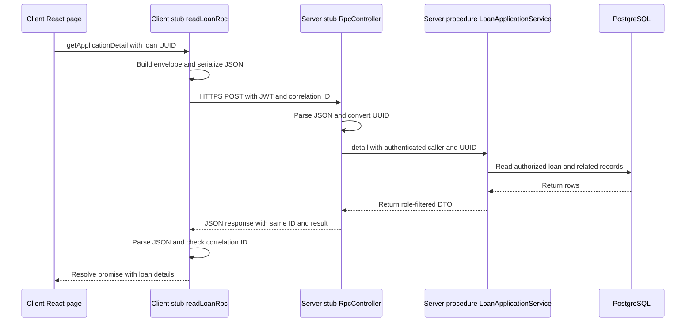

# Remote procedure calls in TrustBank

A remote procedure call lets a client name an operation to run in another process and send its arguments over the network. TrustBank now exposes authenticated **JSON-RPC 2.0** at `POST /api/v1/rpc`. It runs through the same Spring Boot HTTPS API and calls the same loan services as the existing REST routes. The dashboard uses RPC when opening a loan detail page. [JSON-RPC 2.0 specification](https://www.jsonrpc.org/specification)

## Files to open

| File | What it does |
| --- | --- |
| [`web/src/api/http/applications.ts`](../../web/src/api/http/applications.ts) | Calls the loan detail procedure from the dashboard’s existing data layer. |
| [`web/src/api/http/loanRpc.ts`](../../web/src/api/http/loanRpc.ts) | Builds a JSON-RPC request and checks the response ID. |
| [`web/src/api/client.ts`](../../web/src/api/client.ts) | Sends HTTPS requests, attaches the bearer token and applies retry rules for reads. |
| [`backend/src/main/java/com/trustbank/loanapp/web/RpcController.java`](../../backend/src/main/java/com/trustbank/loanapp/web/RpcController.java) | Parses the envelope, dispatches the two named methods and serializes the result or error. |
| [`backend/src/main/java/com/trustbank/loanapp/service/LoanApplicationService.java`](../../backend/src/main/java/com/trustbank/loanapp/service/LoanApplicationService.java#L206) | Runs the same read-only transactions, authorization and privacy rules used by REST. |
| [`backend/src/test/java/com/trustbank/loanapp/web/RpcControllerTest.java`](../../backend/src/test/java/com/trustbank/loanapp/web/RpcControllerTest.java) | Checks dispatch, response IDs, borrower isolation, invalid requests and batch limits. |

## Procedures and parameters

| Method | Parameter | Result |
| --- | --- | --- |
| `loan.getApplication` | `applicationId`, the UUID of an application | The same role-filtered detail DTO as `GET /api/v1/applications/{id}`. |
| `loan.getRepaymentSchedule` | `applicationId`, the UUID of an application | Its repayment installments, ordered by installment number. |

Both accept named parameters such as `{"applicationId":"…"}` or a one-item positional array such as `["…"]`. The server reads the caller’s identity from the bearer token. A borrower can only read their own application and receives the same not-found result for a missing loan or a loan owned by someone else. Staff see the same role-dependent data as through REST.

## Map the textbook RPC roles to TrustBank

The **client** and **server** do the application work. Their **stubs** adapt that work to network messages. In this project the stubs are hand-written. More than one file contributes to the client stub’s job. [The general RPC model](https://www.rfc-editor.org/rfc/rfc5531.html#section-4)

| RPC concept | Where to point in TrustBank | What it does |
| --- | --- | --- |
| **Client or caller** | [`web/src/pages/ApplicationDetailPage.tsx`](../../web/src/pages/ApplicationDetailPage.tsx#L66) → `ApplicationDetailPage.load()` | Takes the loan ID from the page route, calls `getApplicationDetail(id)`, and stores the returned data with `setBundle`. |
| **Client stub or proxy** | [`web/src/api/http/applications.ts`](../../web/src/api/http/applications.ts#L14) → `getApplicationDetail()`, then [`web/src/api/http/loanRpc.ts`](../../web/src/api/http/loanRpc.ts#L10) → `readLoanRpc()` | Makes the operation look like a normal TypeScript function returning a promise. It selects `loan.getApplication`, constructs the envelope, and checks the reply before exposing the result to the page. |
| **Client transport** | [`web/src/api/client.ts`](../../web/src/api/client.ts#L65) → `request()` | Combines the configured API origin with `/api/v1/rpc`, attaches the bearer token, serializes the body, sends the POST, and parses the HTTP response. |
| **Server process** | Spring Boot on Vercel, with embedded Tomcat and [`backend/src/main/java/com/trustbank/loanapp/security/JwtAuthFilter.java`](../../backend/src/main/java/com/trustbank/loanapp/security/JwtAuthFilter.java#L31) | Accepts the HTTP request and authenticates the caller. Spring MVC routes the request to the RPC adapter. |
| **Server stub or skeleton** | [`backend/src/main/java/com/trustbank/loanapp/web/RpcController.java`](../../backend/src/main/java/com/trustbank/loanapp/web/RpcController.java#L70) → `invoke()`, `dispatch()`, `call()` | Parses JSON, validates the envelope and arguments, selects an allowed Java method, and wraps its result or error. |
| **Server procedure or implementation** | [`backend/src/main/java/com/trustbank/loanapp/service/LoanApplicationService.java`](../../backend/src/main/java/com/trustbank/loanapp/service/LoanApplicationService.java#L206) → `detail(caller, applicationId)` or [`backend/src/main/java/com/trustbank/loanapp/service/LoanApplicationService.java`](../../backend/src/main/java/com/trustbank/loanapp/service/LoanApplicationService.java#L246) → `schedule(caller, applicationId)` | Applies the access rules, reads PostgreSQL in a read-only transaction and returns the relevant DTOs. |
| **Contract** | [`web/src/api/http/loanRpc.ts`](../../web/src/api/http/loanRpc.ts#L3) and [`backend/src/main/java/com/trustbank/loanapp/web/dto/LoanDtos.java`](../../backend/src/main/java/com/trustbank/loanapp/web/dto/LoanDtos.java#L92) | The transport contract defines method names, the UUID argument, the envelope and the DTOs. TypeScript types help the client developer at compile time. The Java stub validates the incoming envelope and UUID at runtime. Swagger documents the HTTP entry point. |

PostgreSQL is the data store behind the server procedure. The React page calls Spring Boot over the network. Once the stub has received the call, it invokes `LoanApplicationService` locally inside that same Java process.

## Four transformations on a round trip

**Marshalling** turns in-memory arguments or results into a format that can cross the network. **Unmarshalling** reads that representation and reconstructs values the receiver can use. The loan UUID passes by value as text. Each process has its own objects and memory.

| Step | Code | Value before and after |
| --- | --- | --- |
| **1. Client marshals the request** | `readLoanRpc()` creates `{ jsonrpc: '2.0', method, params: { applicationId }, id }`. [`web/src/api/client.ts`](../../web/src/api/client.ts#L82) supplies `JSON.stringify(options.body)` to `fetch`. | JavaScript loan ID and envelope object → JSON text in the HTTP POST body. The JWT goes in the `Authorization` header. |
| **2. Server unmarshals the request** | [`backend/src/main/java/com/trustbank/loanapp/web/RpcController.java`](../../backend/src/main/java/com/trustbank/loanapp/web/RpcController.java#L74) uses `requestReader.readTree(body)`. [`backend/src/main/java/com/trustbank/loanapp/web/RpcController.java`](../../backend/src/main/java/com/trustbank/loanapp/web/RpcController.java#L148) extracts `applicationId` and calls `UUID.fromString(...)`. | HTTP body bytes → Jackson `JsonNode` → method name, typed Java `UUID` and reply ID. The authenticated `AuthUser` comes from Spring Security. |
| **3. Server marshals the reply** | [`backend/src/main/java/com/trustbank/loanapp/web/RpcController.java`](../../backend/src/main/java/com/trustbank/loanapp/web/RpcController.java#L123) executes the local procedure and uses `json.valueToTree(result)` to put its DTO under `result`. `envelope(id)` adds the version and ID. Spring’s Jackson message converter writes the tree as JSON. | Java `ApplicationDetailDto` or list of `ScheduleItemDto` values → JSON tree → HTTP response body. Application failures use `error`. |
| **4. Client unmarshals the reply** | [`web/src/api/client.ts`](../../web/src/api/client.ts#L91) calls `response.json()`. [`web/src/api/http/loanRpc.ts`](../../web/src/api/http/loanRpc.ts#L31) checks the version, matching ID and result-or-error shape before returning `reply.result`. | HTTP JSON body → JavaScript object → plain loan data used by the page. An error envelope becomes an `ApiError`. |

## Follow one loan detail call



### The key code to point to

The client stub chooses the remote method and constructs the parameters and correlation ID. The HTTP helper handles the actual string serialization.

```ts
reply = await request<RpcResponse<T>>('/api/v1/rpc', {
  method: 'POST',
  readOnly: true,
  body: { jsonrpc: '2.0', method, params: { applicationId }, id },
})
```

The server stub has already parsed the JSON and validated the UUID when it makes this local call. It then prepares the reply for Spring to serialize.

```java
Object result = detail ? loans.detail(caller, applicationId) : loans.schedule(caller, applicationId);
return envelope(id).set("result", json.valueToTree(result));
```

### Related RPC concepts

| Concept | How it works here |
| --- | --- |
| **Binding or locating the server** | `VITE_API_URL` supplies the backend origin. The client stub adds `/api/v1/rpc`. Spring’s `@PostMapping` binds that path and HTTP method to `invoke()`. DNS resolves the hostname. The project uses configured routing with no RPC registry. |
| **Dispatch** | The stub examines `method` and routes only `loan.getApplication` and `loan.getRepaymentSchedule`. The names are protocol strings. The dispatcher maps them explicitly to `detail()` and `schedule()`. |
| **Correlation** | `crypto.randomUUID()` creates the request `id`, and the server echoes it. In a batch, IDs let the client associate replies with calls. `jsonrpc: "2.0"` is the protocol version. `applicationId` is the loan’s database identity. |
| **Invocation style** | The page calls a function and receives a result later through a promise. It uses `.then(setBundle)`. An `await` in the stub waits within that async function while the browser remains free to handle other work. The backend reads data synchronously on its request worker. |
| **Transport failure and retry semantics** | The shared client can retry these read-only POSTs on network failures or HTTP 503 under its existing retry rules. Multiple attempts may run the same query. The reply ID provides correlation. A write would need its own idempotency mechanism because a timeout can happen after the server acted. |
| **Protocol and business errors** | A reply can use HTTP 200 and carry a JSON-RPC `error`. For example, `-32601` means unknown procedure and `-32004` is this app’s loan-not-found code. HTTP 401 comes from the security layer before RPC dispatch. |
| **Payload and transport** | JSON-RPC defines the call and reply envelopes. HTTPS carries them. TLS protects data in transit, and the JWT identifies who is making the request. |

If the dashboard reaches an older backend and the RPC route returns HTTP 404 or 405 at the transport layer, the client calls the REST detail endpoint. A loan-not-found reply inside a JSON-RPC envelope is handled as an RPC error and does not trigger that fallback.

## Demonstrate a request in Swagger

Open your running backend’s `/swagger-ui.html`, authorize the `rpcBearer` scheme with a genuine JWT, and locate `POST /api/v1/rpc`. Substitute an application UUID accessible to your account.

```json
{
  "jsonrpc": "2.0",
  "method": "loan.getApplication",
  "params": {
    "applicationId": "11111111-1111-1111-1111-111111111111"
  },
  "id": "demo-1"
}
```

A success response has `jsonrpc: "2.0"`, the matching `id: "demo-1"` and the loan detail under `result`. Try changing `method` to `loan.unknown`. The backend returns the same ID with `error.code: -32601` for a method it does not expose. Malformed JSON returns `-32700`, an invalid envelope returns `-32600`, and invalid method parameters return `-32602`. A missing or unauthorized loan is a JSON-RPC error with `code: -32004` and `data.status: 404`. An absent or expired JWT is rejected by the HTTP security layer before dispatch.

A batch can contain up to ten calls and gets an array of replies matched by ID. A JSON-RPC notification leaves out the `id`, so the server sends no result or error for that call. A batch or request containing only well-formed notifications returns HTTP 204. This protocol use of “notification” refers to a one-way call. Borrower notifications still travel through the outbox and AMQP worker described in the middleware guide.

## Presentation questions

**How does this differ from REST in our app?** The REST client chooses the resource using `GET /api/v1/applications/{id}`. The RPC client posts to one endpoint and names the operation in `method`, with the input UUID under `params`. Both transports reuse the same PostgreSQL query and access rules.

**Is the Spring controller the real procedure?** The controller is the server stub. It speaks the protocol and calls the application service. The service performs the loan query.

**What would you point to for marshalling?** Show the client’s `JSON.stringify(...)` for the request, the server’s `readTree(...)` and `UUID.fromString(...)` for request decoding, the server’s `valueToTree(...)` and Jackson converter for the reply, then `response.json()` for client decoding.

[Transactions and ACID](01-TRANSACTIONS-ACID.md) · [Message Oriented Middleware](02-MESSAGE-ORIENTED-MIDDLEWARE.md) · [Sockets](05-SOCKETS-TCP-UDP.md) · [Concurrency](06-CONCURRENCY.md)
