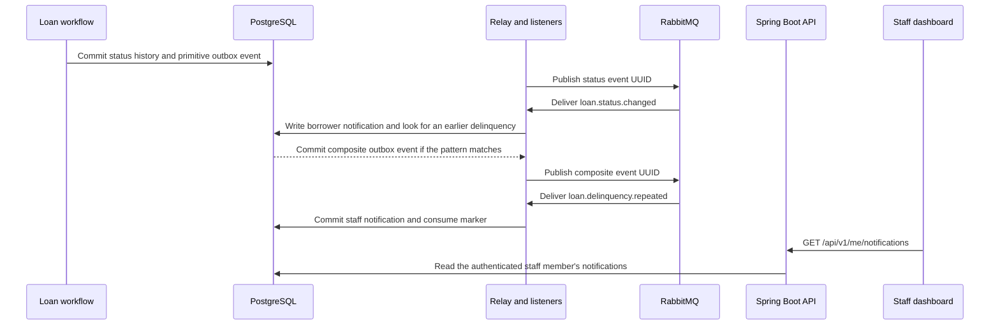

# Composite Event Detection in TrustBank

The middleware lecture calls a single occurrence a **primitive event** and a pattern of related occurrences a **composite event**. TrustBank detects two transitions from `ACTIVE` to `DELINQUENT` on one loan within 30 elapsed days and publishes a staff follow-up event. The detector compares the committed event timestamps. RabbitMQ delivery times can vary.

## Files to open

| File | Responsibility |
| --- | --- |
| [RepaymentService.java](../../backend/src/main/java/com/trustbank/loanapp/service/RepaymentService.java#L98) | Returns a caught-up loan to `ACTIVE` and marks an active loan `DELINQUENT` when an installment becomes overdue. |
| [NotificationProcessor.java](../../backend/src/main/java/com/trustbank/loanapp/messaging/NotificationProcessor.java) | Runs detection when it receives an eligible status event through RabbitMQ. |
| [V7__repeat_delinquency_events.sql](../../backend/src/main/resources/db/migration/V7__repeat_delinquency_events.sql) | Finds the matching history rows, stores a derived outbox event and records the final staff alert. |
| [RabbitMessagingConfig.java](../../backend/src/main/java/com/trustbank/loanapp/messaging/RabbitMessagingConfig.java) | Routes the derived event with `loan.delinquency.repeated` to the staff-alert queue, which has its own dead-letter queue. |
| [RabbitNotificationConsumer.java](../../backend/src/main/java/com/trustbank/loanapp/messaging/RabbitNotificationConsumer.java) | Subscribes to both queues and delegates to the appropriate transactional handler. |
| [StaffNotifications.tsx](../../web/src/components/layout/StaffNotifications.tsx) | Displays the signed-in staff member’s alerts, links to the loan and lets the recipient mark an alert as read. |

## From status change to staff alert



1. **Primitive event.** The overdue-installment sweep moves an active loan to `DELINQUENT`. Paying overdue installments can return it to `ACTIVE`, which lets a later overdue installment cause a separate delinquency. Each transition writes a history row and a primitive outbox event in the same loan transaction.
2. **Correlation and time window.** The RabbitMQ status listener passes the committed event UUID to Spring. For an `ACTIVE` to `DELINQUENT` change, PostgreSQL looks up the same loan’s most recent earlier matching transition. The lower bound is inclusive, so a gap of exactly 720 hours qualifies. The event ID breaks ties between equal timestamps. A later event can arrive at the listener first because both changes are already in the database.
3. **Composite event.** PostgreSQL gives the derived event its own UUID and records the two source IDs and timestamps. The unique combination of later source event and derived event type allows only one follow-up per qualifying later transition. The original notification and creation of the composite outbox row commit together before the status listener acknowledges delivery.
4. **Delivery.** The existing relay claims and publishes the new row. The staff listener records one notification for the assigned active loan officer. If that officer is unavailable, it selects an active administrator, ordered by account creation and ID. The notification and consume marker commit together. If there is no eligible recipient, the message follows the broker retry and dead-letter path. An administrator can requeue its event ID through the existing messaging API after restoring an eligible recipient.
5. **Presentation.** The recipient opens the dashboard bell. The web client refreshes the panel through `GET /api/v1/me/notifications` each time it opens. The server identifies the recipient from the authenticated account. Borrower notifications continue through the existing status flow.

## Key SQL

This excerpt from `detect_repeat_delinquency` shows the matching rule. `current_event` is the history row that triggered detection.

```sql
WHERE h.loan_application_id = current_event.loan_application_id
  AND h.from_status = 'ACTIVE' AND h.to_status = 'DELINQUENT'
  AND h.changed_at >= current_event.changed_at - interval '720 hours'
  AND (h.changed_at, h.id) < (current_event.changed_at, current_event.id)
ORDER BY h.changed_at DESC, h.id DESC
LIMIT 1
```

The insert ends with `ON CONFLICT (source_history_id, event_type) DO NOTHING`. This makes retries safe even if the broker redelivers the original status after PostgreSQL has committed. The staff-delivery procedure independently deduplicates deliveries of the derived event.

## Demonstration

Use the [local messaging stack](../../backend/DATABASE-MESSAGING.md) with an isolated database and RabbitMQ instance. Flyway applies V7 on startup. The feature runs when the existing RabbitMQ worker is enabled. Earlier history can satisfy the first part of a new match, and historical notifications are left as recorded.

Run the [messaging integration tests](../../backend/src/test/java/com/trustbank/loanapp/messaging/LoanMessagingIntegrationTest.java) with `TEST_DATABASE_URL`, `TEST_DATABASE_USER` and `TEST_DATABASE_PASSWORD`. For the broker test, set `TEST_RABBITMQ_ADDRESS` to a dedicated test broker or virtual host, since the test creates and removes queues. The tests cover the exact 30-day boundary, reverse delivery order, duplicates, events on different loans and the administrator fallback.

For a live walkthrough on the local stack, have an assigned test loan become overdue, catch up its repayments, then become overdue again within 30 days. Open the bell while signed in as its assigned officer. The second overdue occurrence should produce one staff notification with a link back to the loan.
